# Exploración de la planificación de procesos en XV6

**Universidad del Valle**
Escuela de Ingeniería de Sistemas y Computación
**Curso:** Sistemas Operativos
**Docente:** John Alexander Sanabria Ordoñez

**Integrantes**

| Nombre | Código |
|---|---|
| Nicol Vanessa Serna Gómez | 2537866-3743 |
| Sara Giraldo Mosquera | 2417139-3743 |
| Nicolas Andres Ramirez Correa | 2415510-3743 |

**Repositorio (fork):** https://github.com/Nicoramirezc/Tarea-SO-xv6-riscv

---

## Reparto de trabajo

| Integrante | Responsabilidad | Secciones |
|---|---|---|
| Nicolas Andres Ramirez Correa | Entorno, compilación, ejecución con una CPU, incorporación de `proc.c` al sistema compilado y ensamblaje del reporte | 1, 2.4, 4.1 y 5 (su párrafo) |
| Nicol Vanessa Serna Gómez | Planificador original | 2.1 a 2.3, 4.2 y 5 (su párrafo) |
| Sara Giraldo Mosquera | MLFQ | 3, 4.3 y 5 (su párrafo) |

Cada integrante trabajó su bloque por separado. Las capturas se nombran con un prefijo según quien las hizo: `a-` para Nicolas, `b-` para Nicol y `c-` para Sara.

---

## 1. Repositorio, entorno y ejecución

### 1.1 Fork y revisión de partida

Se hizo un fork del repositorio oficial `mit-pdos/xv6-riscv` y se clonó dentro de WSL2.

| Dato | Valor |
|---|---|
| Rama de trabajo | `riscv` |
| Commit de partida | `fa2ddcb7ca87a77af579380a6eafd5aff163b44f` |
| Mensaje del commit | `usertests: bound the zero-length pipe read regression test` |
| Autor y fecha | koki kitamura, 30 de octubre de 2026 |

### 1.2 Entorno

El trabajo se hizo en Windows 11 con WSL2 y una distribución Debian. XV6 se clonó, compiló y ejecutó dentro del sistema de archivos de Linux (`~/projects/...`), no en `/mnt/c`.

| Componente | Versión |
|---|---|
| Sistema operativo | Debian GNU/Linux 13 (trixie) |
| Kernel de Linux | `6.18.58.1-microsoft-standard-WSL2` |
| Compilador cruzado | `riscv64-linux-gnu-gcc (Debian 14.2.0-19) 14.2.0` |
| Emulador | QEMU emulator version 10.0.13 (Debian 1:10.0.13+ds-0+deb13u1) |
| GNU Make | 4.4.1 (x86_64-pc-linux-gnu) |
| WSL | 3.0.5.0 (kernel 6.18.58.1-1, WSLg 1.0.79, MSRDC 1.2.7391, Direct3D 1.611.1-81528511, DXCore 10.0.26100.1-240331-1435.ge-release) |
| Windows | 10.0.26300.9974 (Windows 11) |

En Debian el compilador cruzado se llama `riscv64-linux-gnu-gcc`. El Makefile de XV6 detecta ese prefijo sin cambios.

Versión de Linux:

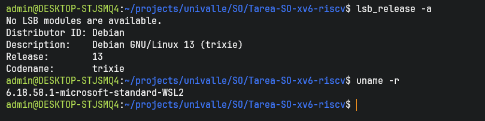

*Figura 1. `lsb_release -a` muestra Debian 13 (trixie) y `uname -r` el kernel de WSL2. El aviso "No LSB modules are available" es normal en Debian.*

Commit de partida y versiones de las herramientas:

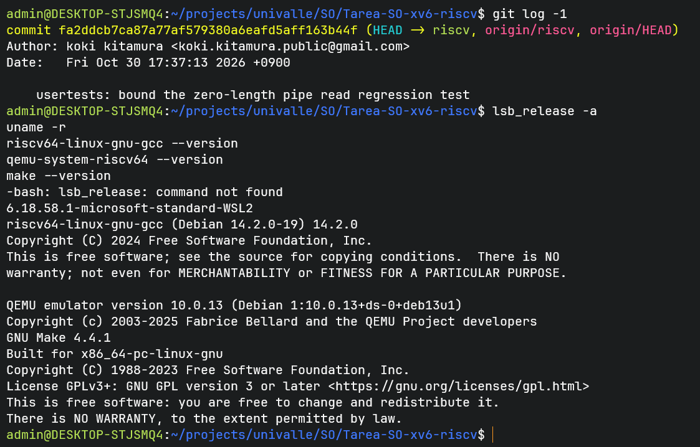

*Figura 2. `git log -1` con el commit de partida, y la versión de gcc, QEMU y make. En esa captura `lsb_release` aún no estaba instalado.*

### 1.3 Instrucciones reproducibles

Desde una terminal de Debian en WSL:

```bash
# 1. Paquetes necesarios
sudo apt update && sudo apt upgrade -y
sudo apt install -y git build-essential gdb-multiarch qemu-system-misc \
  gcc-riscv64-linux-gnu binutils-riscv64-linux-gnu bc lsb-release

# 2. Clonar el fork
cd ~
git clone https://github.com/Nicoramirezc/Tarea-SO-xv6-riscv.git
cd Tarea-SO-xv6-riscv
git log -1          # commit de partida

# 3. Versiones de las herramientas
lsb_release -a
uname -r
riscv64-linux-gnu-gcc --version
qemu-system-riscv64 --version
make --version

# 4. Compilar y ejecutar con las 3 CPUs por defecto
make qemu

# 5. Compilar y ejecutar con una sola CPU virtual
make qemu CPUS=1
```

Dentro de XV6 se usan los comandos `ls` y `cat README`. Para salir de QEMU se pulsa `Ctrl+A` y luego `X`.

Se instaló `bc` porque el objetivo `qemu` del Makefile (regla `check-qemu-version`, línea 198) lo usa para comprobar que QEMU sea 7.2 o superior. Sin `bc`, `make qemu` imprime `bc: not found` y `Illegal number`, pero QEMU arranca igual.

### 1.4 XV6 operativo

Después de `make qemu`, el kernel imprime `xv6 kernel is booting` y `init: starting sh`, y aparece el prompt `$`.

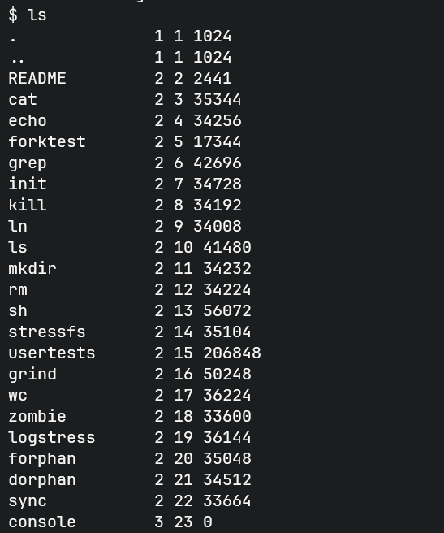

*Figura 3. `ls` en XV6. Cada línea trae nombre, tipo (1 directorio, 2 archivo, 3 dispositivo), número de inodo y tamaño en bytes. Se ven `.` y `..`, el archivo `README`, los programas de usuario (`cat`, `echo`, `grep`, `sh`, `usertests`, entre otros) y `console`, que es un dispositivo (tipo 3).*

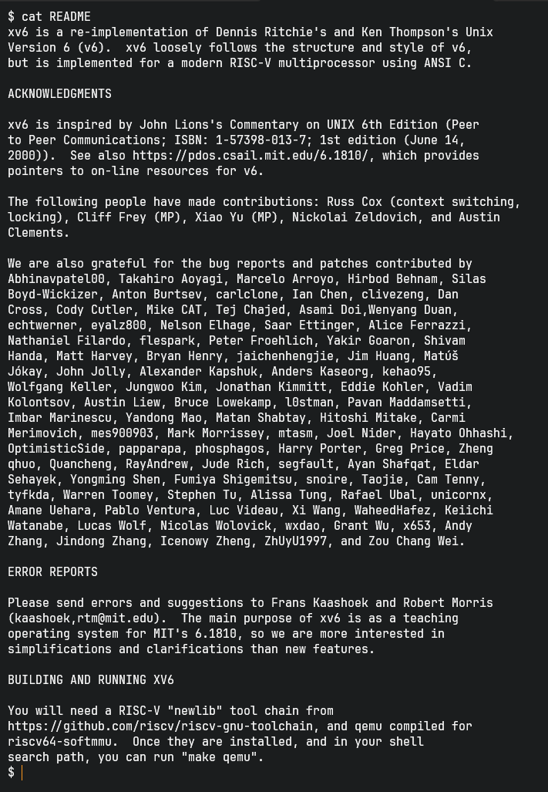

*Figura 4. `cat README` imprime el archivo README del sistema de archivos de XV6: la descripción del proyecto, los agradecimientos y las instrucciones de compilación. Que se pueda leer ese texto muestra que el shell, el sistema de archivos y la consola funcionan.*

### 1.5 Ejecución con una sola CPU virtual

El número de CPUs lo fija la variable `CPUS` del Makefile, que llega a QEMU mediante `-smp`:

```make
ifndef CPUS
CPUS := 3
endif

QEMUOPTS = -machine virt -bios none -kernel $K/kernel -m 128M -smp $(CPUS) -nographic
```

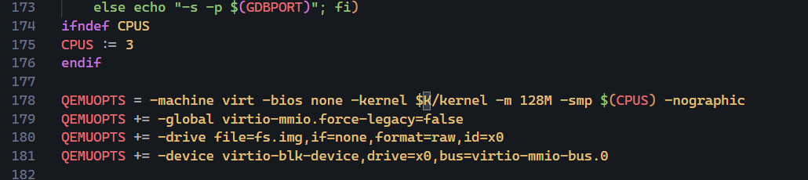

*Figura 5. Líneas 174 a 178 del Makefile. Si `CPUS` no está definida vale 3, y `-smp $(CPUS)` se pasa a QEMU.*

Un valor dado en la línea de comandos tiene prioridad sobre el del Makefile, así que el comando es:

```bash
make qemu CPUS=1
```

Evidencia de que corre con un solo hart:

1. La línea de QEMU que imprime `make` contiene `-smp 1`. Con la ejecución por defecto contiene `-smp 3`.
2. Con las 3 CPUs, el arranque imprime `hart 1 starting` y `hart 2 starting`. Con `CPUS=1` esos mensajes no aparecen.
3. En el monitor de QEMU (`Ctrl+A` y luego `C`), `info cpus` lista una sola CPU:

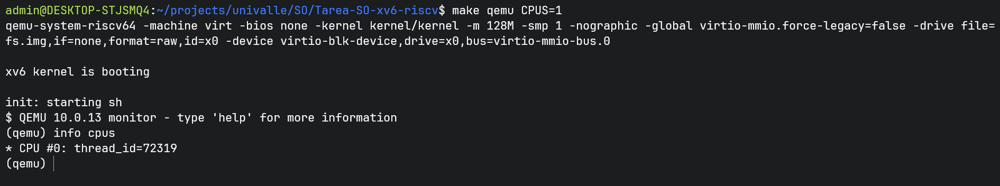

*Figura 6. Con `make qemu CPUS=1`, `info cpus` muestra únicamente `CPU #0`.*

---

## 2. Planificador original

### 2.1 Algoritmo de planificación por defecto

**¿Qué algoritmo o política de planificación utiliza XV6 por defecto?**

**Respuesta:** El algoritmo de planificación que utiliza XV6 es round-robin: los procesos se atienden por turnos, cada uno con un tiempo limitado en la CPU, y al terminar de atender a todos los procesos se regresa al primero.

**Evidencia en el código.** En la función `scheduler()` del archivo `kernel/proc.c` se puede evidenciar que esta función recorre el arreglo desde la posición 0, es decir, los procesos se atienden en el orden de su posición en el arreglo. En la siguiente línea se selecciona un proceso:

```c
if (p->state == RUNNABLE) {
  p->state = RUNNING;
  c->proc = p;
  swtch(&c->context, &p->context);
  ...
}
```

Si el proceso está listo (`RUNNABLE`), cambia su estado a `RUNNING` y entra a la CPU; si no, se pasa al siguiente. Dentro de `scheduler()` no se ven prioridades ni se define cuánto tiempo debe durar un proceso en la CPU. Esa duración se determina por la interrupción del timer.

¿Cómo se limitan los turnos? En `kernel/start.c`, `timerinit()` programa la primera alarma con `w_stimecmp(r_time() + 1000000)`, y en `kernel/trap.c`, la función `clockintr()` repite esa misma línea cada vez que la alarma suena, así que las interrupciones llegan a intervalos regulares.

Cuando el timer interrumpe, `devintr()` identifica la causa, llama a `clockintr()` y devuelve 2, que es la señal de que fue el timer. Con ese valor, `usertrap()` ejecuta `if (which_dev == 2) yield();`. Si la interrupción ocurre mientras el procesador está en código del kernel, `kerneltrap()` hace lo mismo.

En `kernel/proc.c`, `yield()` no mueve el proceso a ninguna cola: solo cambia su estado a `RUNNABLE` (`p->state = RUNNABLE`) y llama a `sched()`. Esta hace `swtch(&p->context, &mycpu()->context)`, que guarda el contexto del proceso y carga el del scheduler. El control vuelve a `scheduler()`, que sigue su recorrido de `proc[]` con `p++` hacia el siguiente proceso `RUNNABLE`.

**Evidencia del comportamiento.** Programa de prueba usado: `user/spin.c` (ver Anexo en 2.5). Comando para ejecutar: `make qemu CPUS=1` y luego, dentro de XV6, `spin`.

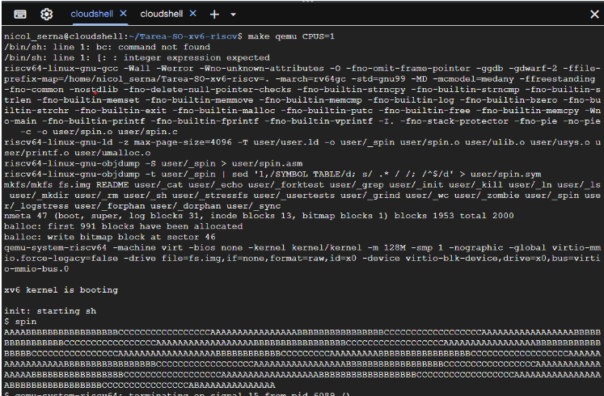

*Figura 7. Salida de `spin` con una sola CPU. El patrón A, B, C se repite varias veces y en el mismo orden, a excepción de la última línea impresa (ABAAAAAA…); una posible causa es que al terminar, los procesos salen en momentos distintos. Ningún proceso termina en su primer turno: el kernel le quita la CPU a cada uno y se la da al siguiente (`usertrap()` llama a `yield()` cuando llega la interrupción de timer), y por eso el patrón se repite.*

### 2.2 Dónde se selecciona el siguiente proceso

La selección del siguiente proceso se hace en `kernel/proc.c`, en la función `scheduler()`.

**Fragmento de código:**

```c
for (p = proc; p < &proc[NPROC]; p++) {
  acquire(&p->lock);
  if (p->state == RUNNABLE) {
    p->state = RUNNING;
    c->proc = p;
    swtch(&c->context, &p->context);
    ...
  }
  release(&p->lock);
}
```

**Explicación:** Esta función recorre `proc[]` desde `proc[0]` hasta `proc[NPROC-1]`, donde `NPROC` es el número máximo de procesos que puede tener XV6. El criterio de selección se encuentra en la única condición del `if`, donde no hay comparación de prioridades ni tiempos. Si el estado del proceso es `RUNNABLE`, cambia a `RUNNING`, se anota en la CPU (`c->proc = p`) y hace `swtch` para que empiece a correr. El scheduler solo continúa cuando ese proceso devuelve la CPU; entonces `p++` y se evalúa la siguiente posición. Cuando termina de recorrer `proc[]` completo, vuelve a recorrerlo por el `for` externo `for (;;)`.

### 2.3 Estados y eventos

**Tabla de transiciones de estados**, relacionando los estados con los eventos que hacen ceder la CPU y los que permiten recuperarla:

| Transición | ¿Qué la provoca? | ¿Dónde? |
|---|---|---|
| RUNNABLE → RUNNING | El scheduler lo elige | `kernel/proc.c`: `scheduler()` |
| RUNNING → RUNNABLE | Interrupción de timer | `kernel/trap.c`: `usertrap()`; `kernel/proc.c`: `yield()` |
| RUNNING → SLEEPING | Espera un evento | `sleep()` en `kernel/proc.c`, llamada desde `kwait()` |
| SLEEPING → RUNNABLE | Llega el evento | `kernel/proc.c`: `wakeup()` |
| RUNNING → ZOMBIE | El proceso termina | `kernel/proc.c`: `kexit()` |

**Eventos que hacen ceder la CPU.** El proceso puede salir por 3 eventos, y cada evento deja al proceso en un estado distinto antes de llamar a `sched()`:

- Interrupción del timer: `usertrap()` llama a `yield()`, que deja al proceso en estado `RUNNABLE`.
- Espera un evento (por ejemplo, espera a un hijo): llama a `sleep_prepare()` y `sleep()`, que lo dejan en `SLEEPING`.
- Cuando terminó: `kexit()` lo deja en `ZOMBIE`.

Luego, `yield()`, `sleep()` y `kexit()` siempre llaman a `sched()` para que guarde el contexto del proceso y lo devuelva a `scheduler()`.

```c
// kernel/trap.c, usertrap(), donde el timer llama a yield() (se omiten partes con ...):
  } else if ((which_dev = devintr()) != 0) {
    // ok
  }
  ...
  // give up the CPU if this is a timer interrupt.
  if (which_dev == 2)
    yield();
```

```c
// kernel/proc.c, yield() (RUNNING → RUNNABLE):
void
yield(void)
{
  struct proc *p = myproc();
  acquire(&p->lock);
  p->state = RUNNABLE;
  sched();
  release(&p->lock);
}
```

**Eventos que permiten recuperar la CPU.**

- (SLEEPING → RUNNABLE): ocurre cuando llega el evento esperado. `wakeup(chan)` recorre `proc[]` y, si el proceso esperaba ese canal y estaba `SLEEPING`, lo deja `RUNNABLE`. No llama a `swtch` ni a `sched()`: solo lo vuelve elegible. Entra a la CPU cuando el `for` de `scheduler()` llega a su posición, sin importar cuándo despertó. Además, `scheduler()` solo continúa cuando el proceso que está corriendo cede la CPU, así que el despertar nunca implica entrar de inmediato.

```c
// kernel/proc.c, sleep_prepare() y sleep() (RUNNING → SLEEPING):
void
sleep_prepare(void *chan)
{
  struct proc *p = myproc();

  acquire(&p->lock);
  if (chan == 0)
    panic("sleep_prepare: zero chan");
  p->chan = chan;
  release(&p->lock);
}

void
sleep(void)
{
  struct proc *p = myproc();

  acquire(&p->lock);
  if (p->chan != 0) {
    p->state = SLEEPING;
    sched();
  }
  release(&p->lock);
}
```

```c
// kernel/proc.c, wakeup() (SLEEPING → RUNNABLE):
void
wakeup(void *chan)
{
  struct proc *p;

  for (p = proc; p < &proc[NPROC]; p++) {
    acquire(&p->lock);
    if (p->chan == chan) {
      p->chan = 0;
      if (p->state == SLEEPING) {
        p->state = RUNNABLE;
      }
    }
    release(&p->lock);
  }
}
```

- (RUNNABLE → RUNNING): `scheduler()` mete el proceso a la CPU cuando el `for` llega a su posición en `proc[]`, sin importar cuándo despertó. Como el scheduler solo continúa cuando el proceso que está corriendo cede la CPU, despertar nunca implica entrar de inmediato.

### 2.4 Cómo entra `proc.c` al sistema compilado (pregunta 3.4 del enunciado)

El código del planificador está en `kernel/proc.c`. Ese archivo llega al sistema que corre en QEMU a través de cinco pasos del Makefile.

**Paso 1. Compilación de `proc.c` a `proc.o`.**
El Makefile no tiene una regla de patrón para los `.c`. La búsqueda `grep -n '%.o' Makefile` solo encuentra la regla de los `.S` (línea 99), la de los programas de usuario (línea 107) y `.PRECIOUS` (línea 131). Los `.c` se compilan con la regla implícita incorporada de `make`, que usa la variable `CFLAGS` definida en las líneas 66 a 89 del Makefile. El log de compilación lo muestra:

```text
riscv64-linux-gnu-gcc -Wall -Werror -Wno-unknown-attributes -O -fno-omit-frame-pointer
 -ggdb -gdwarf-2 ... -march=rv64gc -std=gnu99 -MD -mcmodel=medany -ffreestanding ...
 -fno-pie -no-pie   -c -o kernel/proc.o kernel/proc.c
```

Las opciones `-ffreestanding` y `-mcmodel=medany` indican que es código de kernel, sin biblioteca estándar. Los tres espacios antes de `-c` coinciden con la receta incorporada `$(CC) $(CFLAGS) $(CPPFLAGS) $(TARGET_ARCH) -c`, donde `CPPFLAGS` y `TARGET_ARCH` están vacías.

**Paso 2. La lista `OBJS`.**
`kernel/proc.o` aparece en la línea 15 de la lista `OBJS` (líneas 4 a 31), junto con los demás objetos del kernel.

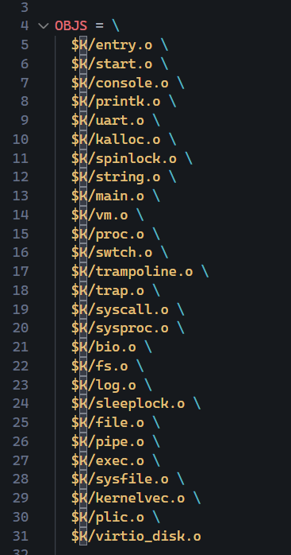

*Figura 8. Lista `OBJS`. `$K/proc.o` está en la línea 15 y `$K/swtch.o` en la 16.*

**Paso 3. Enlazado.**
La regla del kernel usa `OBJS` en dos sitios: como prerrequisito, y como argumento del enlazador.

```make
$K/kernel: $(OBJS) $K/kernel.ld
	$(LD) $(LDFLAGS) -T $K/kernel.ld -o $K/kernel $(OBJS)
	$(OBJDUMP) -S $K/kernel > $K/kernel.asm
	$(OBJDUMP) -t $K/kernel | sed '1,/SYMBOL TABLE/d; s/ .* / /; /^$$/d' > $K/kernel.sym
```

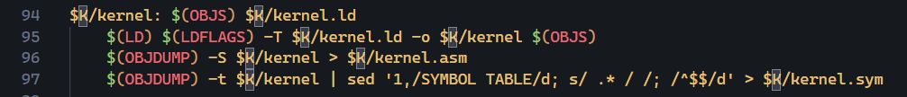

*Figura 9. Líneas 94 a 97 del Makefile. Las líneas `objdump` forman parte de la receta de `$K/kernel` y generan `kernel.asm` y `kernel.sym`.*

El enlazador junta todos los `.o` en un único ejecutable ELF, `kernel/kernel`. Ahí `proc.o` queda mezclado con el resto del kernel: no hay un módulo de planificación separado. El log de `make qemu` lo confirma, porque `kernel/proc.o` aparece en la lista de `riscv64-linux-gnu-ld`.

**Paso 4. El script `kernel/kernel.ld`.**
El script se pasa con `-T`. Dos líneas importan para esta tarea:

```text
2:  ENTRY( _entry )
10: . = 0x80000000;
```

`ENTRY(_entry)` fija el punto de entrada y `. = 0x80000000;` la dirección base. En el ELF resultante, `readelf -h` muestra `Entry point address: 0x80000000` y `readelf -l` un segmento `LOAD` con dirección virtual y física `0x80000000` (`FileSiz 0xa2f0`, `MemSiz 0x23628`, permisos `RWE`). Esos permisos explican el aviso `has a LOAD segment with RWX permissions` que imprime `ld`.

**Paso 5. Carga por QEMU.**
La línea 178 del Makefile pasa el ejecutable con `-kernel $K/kernel`, junto con `-bios none`. Con esas opciones QEMU carga el ELF en la memoria de la máquina virtual y empieza a ejecutarlo. Al arrancar corre `_entry`, y de ahí el kernel llega a `main()` y a `scheduler()`, que están en `proc.c`.

**Dependencias de cabeceras.**
La opción `-MD` hace que cada compilación genere un `.d` en `kernel/` con las cabeceras de las que depende el `.c`. La línea 158 del Makefile los incorpora con `-include kernel/*.d user/*.d`. Por eso modificar un `.h` también provoca la recompilación de los `.c` que lo incluyen.

**Comprobación con tres ejecuciones.**

Se borró `kernel/proc.o` y se ejecutó `make kernel/kernel`. Después se hizo `touch kernel/proc.c` y se repitió. En ambos casos `make` ejecutó las mismas recetas y ninguna otra:

```text
riscv64-linux-gnu-gcc ... -c -o kernel/proc.o kernel/proc.c
riscv64-linux-gnu-ld -z max-page-size=4096 -T kernel/kernel.ld -o kernel/kernel kernel/entry.o ... kernel/proc.o ... kernel/virtio_disk.o
riscv64-linux-gnu-ld: warning: kernel/kernel has a LOAD segment with RWX permissions
riscv64-linux-gnu-objdump -S kernel/kernel > kernel/kernel.asm
riscv64-linux-gnu-objdump -t kernel/kernel | sed ... > kernel/kernel.sym
```

Una tercera ejecución sin tocar nada dio:

```text
make: 'kernel/kernel' is up to date.
```

Las dos primeras corridas muestran que el cambio en `proc.c` solo recompila `proc.o` y vuelve a enlazar. Los demás objetos no se recompilaron. La tercera muestra que `make` decide por fechas de modificación y por las dependencias declaradas, y que `OBJS` entra en esa cadena como prerrequisito de `$K/kernel`.

**Cadena completa:**

```text
kernel/proc.c --(regla implícita de make + CFLAGS)--> kernel/proc.o
kernel/proc.o + demás .o de OBJS --(ld -T kernel.ld)--> kernel/kernel (ELF, entrada 0x80000000)
kernel/kernel --(qemu -kernel kernel/kernel -bios none)--> XV6 en ejecución
```

**Comprobaciones adicionales.**

1. `make -p -n kernel/kernel` lista la regla `%.o: %.c` con la receta `$(COMPILE.c) $(OUTPUT_OPTION) $<`, marcada como `(built-in)`. Es la regla incorporada de `make` que compila `proc.c`, no una regla del Makefile de XV6.

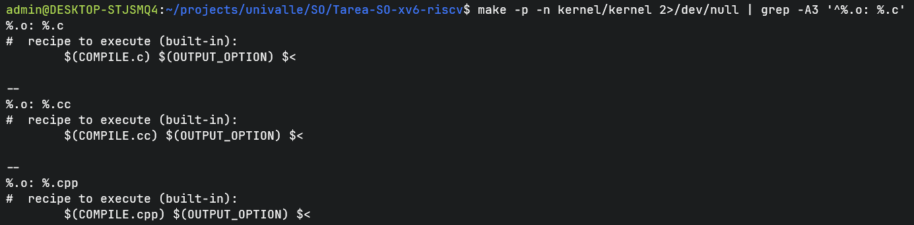

*Figura 10. Salida de `make -p -n kernel/kernel 2>/dev/null | grep -A3 '^%.o: %.c'`.*

2. `nm` sobre `kernel/kernel` ubica el símbolo `_entry` en `0x80000000`, igual que el campo `Entry point address` de `readelf -h`.

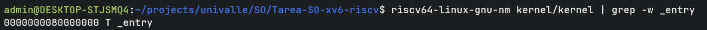

*Figura 11. `riscv64-linux-gnu-nm kernel/kernel | grep -w _entry` da `0000000080000000 T _entry`.*

3. En el monitor de QEMU, `info mtree` muestra que la región `riscv_virt_board.ram` va de `0x80000000` a `0x87ffffff`. Son 128 MiB, el tamaño que se pidió con `-m 128M`. La dirección de `kernel.ld` coincide con el inicio de la RAM de la máquina `virt`.

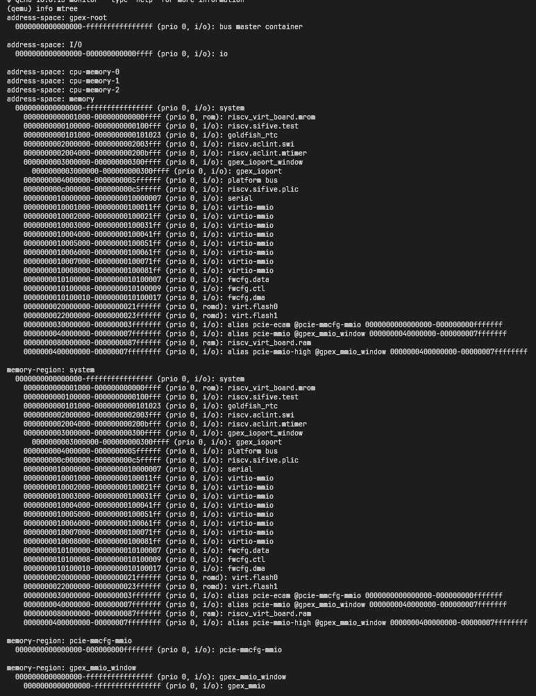

*Figura 12. `info mtree` en el monitor de QEMU. La región `ram` empieza en `0x80000000`; las regiones anteriores son dispositivos y ROM.*

### 2.5 Anexo: programa de prueba `user/spin.c`

```c
#include "kernel/types.h"
#include "user/user.h"

// Crea 3 procesos hijos que consumen CPU y escriben su letra
int
main(int argc, char *argv[])
{
  int n = 3;

  for (int i = 0; i < n; i++) {
    int pid = fork();
    if (pid < 0) {
      printf("fork failed\n");
      exit(1);
    }
    if (pid == 0) {
      char c = 'A' + i;
      for (int k = 0; k < 20; k++) {
        for (volatile long j = 0; j < 20000000; j++)
          ;
        write(1, &c, 1);
      }
      exit(0);
    }
  }

  for (int i = 0; i < n; i++)
    wait(0);
  printf("\n");
  exit(0);
}
```

---

## 3. Exploración de MLFQ

### 3.1 Descripción inicial de MLFQ

MLFQ (o múltiples-colas-con-retroalimentación) es un algoritmo de planificación muy usado en sistemas operativos modernos. Se basa en resolver dos problemas existentes en planificación: disminuir el tiempo de retorno y el tiempo de respuesta.

Se diferencia de otros algoritmos porque no conoce de antemano los tiempos que van a tardar los procesos en ejecutarse dentro de la CPU. Debemos entender un par de cosas: tenemos al menos dos tipos de procesos, los intensivos y los interactivos (es decir, los que usan intensivamente la CPU y los que hacen uso de ella por ráfagas); existen varias colas, cada una con un nivel de prioridad distinto.

Tiene 5 reglas:

- Si Prioridad(A) > Prioridad(B), se ejecuta A.
- Si Prioridad(A) = Prioridad(B), A y B se ejecutan con Round Robin.
- Todo trabajo nuevo entra en la prioridad más alta.
- Si un trabajo agota su asignación de tiempo en una cola (sin importar cuántas veces entregó la CPU), baja de prioridad.
- Cada cierto período S, todos los trabajos suben a la prioridad más alta.

Un ejemplo de este algoritmo puede ser Solaris, donde se hace uso de tablas configurables para definir cada cuanto se resetean las prioridades, así como que el time slice de cada prioridad crece de a 20 ms entre sus 60 colas.

Como dudas quedan: ¿cómo definir la cantidad de colas necesarias? ¿cuáles son los criterios para los time slice de cada cola, el tiempo de reseteo de prioridades? ¿por qué sólo algunos sistemas reservan la alta prioridad para sólo procesos del sistema operativo?

### 3.2 Prompt 1

```text
Actúa como tutor socrático de una pareja de estudiantes de cuarto semestre de Ingeniería de Sistemas. Conocemos C++ y hemos comenzado a explorar XV6 para RISC-V.

Queremos identificar y justificar qué se necesitaría para incorporar MLFQ a XV6. En esta entrega no vamos a implementarlo.

Nuestra descripción inicial del algoritmo, escrita antes de esta conversación: MLFQ (o múltiples-colas-con-retroalimentación) es un algoritmo de planificación muy usado en sistemas operativos modernos. Se basa en resolver dos problemas existentes en planificación: disminuir el tiempo de retorno y el tiempo de respuesta.

Se diferencia de otros algoritmos porque no conoce de antemano los tiempos que van a tardar los procesos en ejecutarse dentro de la CPU. Debemos entender un par de cosas: tenemos al menos dos tipos de procesos, los intensivos y los interactivos (es decir, los que usan intensivamente la CPU y los que hacen uso de ella por ráfagas); existen varias colas, cada una con un nivel de prioridad distinto.

Tiene 5 reglas:
- Si Prioridad(A) > Prioridad(B), se ejecuta A.
- Si Prioridad(A) = Prioridad(B), A y B se ejecutan con Round Robin.
- Todo trabajo nuevo entra en la prioridad más alta.
- Si un trabajo agota su asignación de tiempo en una cola (sin importar cuántas veces entregó la CPU), baja de prioridad.
- Cada cierto período S, todos los trabajos suben a la prioridad más alta.

Un ejemplo de este algoritmo puede ser Solaris, donde se hace uso de tablas configurables para definir cada cuanto se resetean las prioridades, así como que el time slice de cada prioridad crece de a 20 ms entre sus 60 colas.

Como dudas quedan: ¿cómo definir la cantidad de colas necesarias? ¿cuáles son los criterios para los time slice de cada cola, el tiempo de reseteo de prioridades? ¿Por qué sólo algunos sistemas reservan la alta prioridad para sólo procesos del sistema operativo?.

Lo que averiguamos del planificador original y de su incorporación al sistema compilado:
Política por defecto: XV6 utiliza Round-Robin sin prioridades ni colas explícitas; los procesos se atienden según su posición en el arreglo estático proc[].

Selección del proceso (kernel/proc.c): La función scheduler() ejecuta un ciclo infinito (for (;;)) que recorre proc[] desde proc[0] hasta proc[NPROC-1]. Cuando encuentra un proceso con p->state == RUNNABLE, cambia su estado a RUNNING, lo asigna a la CPU (c->proc = p) y transfiere la ejecución mediante swtch(&c->context, &p->context) (definida en kernel/swtch.S).

Interrupción de timer y expulsión (kernel/start.c, kernel/trap.c, kernel/proc.c): timerinit() programa la alarma inicial y clockintr() la reprograma periódicamente (w_stimecmp(r_time() + 1000000)). Cuando ocurre la interrupción de reloj, devintr() devuelve 2 y tanto usertrap() como kerneltrap() invocan yield(). yield() cambia el estado del proceso de RUNNING a RUNNABLE y llama a sched(), que mediante swtch() devuelve el control a scheduler() para continuar recorriendo proc[].

Bloqueo, despertar y finalización (kernel/proc.c): Si un proceso espera un evento (como E/S o kwait()), sleep_prepare() y sleep() lo pasan de RUNNING a SLEEPING y llaman a sched(). Cuando llega el evento, wakeup(chan) recorre proc[] y cambia de SLEEPING a RUNNABLE a los procesos que esperaban ese canal, sin otorgarles la CPU de inmediato. Al finalizar, kexit() marca el proceso como ZOMBIE.

Compilación e incorporación (Makefile, kernel/kernel.ld): kernel/proc.c se compila a kernel/proc.o, se incluye en la lista OBJS del Makefile y se enlaza con ld usando kernel/kernel.ld en el ejecutable ELF kernel/kernel, que QEMU carga con la opción -kernel.

Reglas de interacción:
1. Formula una sola pregunta principal por turno y espera nuestra respuesta. No presentes una lista completa de cambios ni una arquitectura resuelta.
2. Empieza examinando nuestra descripción de MLFQ. Ayúdanos a detectar reglas ambiguas, ausentes o contradictorias. No sustituyas nuestra descripción por una versión terminada ni elijas silenciosamente una variante del algoritmo.
3. Pídenos que propongamos y justifiquemos las decisiones que faltan. Después, ayúdanos a comprobarlas con ejemplos pequeños de procesos y decisiones de planificación que nosotros debamos resolver.
4. Guíanos para relacionar cada regla con XV6. Antes de sugerir una modificación, pregúntanos qué comportamiento necesitamos y qué evidencia del código respalda nuestra propuesta.
5. No supongas que tienes acceso a nuestro repositorio. Pide los fragmentos necesarios y distingue lo observado de lo que todavía sea una hipótesis. No inventes archivos, funciones o comportamientos de nuestra versión.
6. No entregues código de implementación, parches, una lista cerrada de archivos por modificar ni pseudocódigo que resuelva el planificador. Revisa nuestras propuestas y señala problemas mediante preguntas y pistas graduales. Puedes explicar conceptos previos con ejemplos mínimos.
7. Si nos bloqueamos, reduce la dificultad de la pregunta y ofrece una pista concreta. Si pedimos la solución directa, conserva el modo socrático.

El objetivo es que nosotros logremos:
A. Redactar una descripción revisada y coherente de la variante de MLFQ considerada.
B. Explicar qué cambios necesitaría XV6 para soportarla, indicando para cada uno su propósito, su relación con las reglas y la evidencia del código que lo justifica.
C. Proponer escenarios para comprobar una futura implementación del algoritmo MLFQ en el sistema operativo XV6. Pídenos que expliquemos qué procesos participarían, qué harían, qué regla comprobaríamos y qué comportamiento esperaríamos observar. No nos entregues los escenarios resueltos. En esta tarea solo los describiremos; no vamos a programarlos ni ejecutarlos.

Mantén el análisis dentro del alcance de una propuesta: no necesitamos implementar MLFQ ni construir un selector de planificadores. Ayúdanos a registrar las cuestiones que queden pendientes de investigación.

Al finalizar, pídenos que redactemos nuestras conclusiones. Comprueba su consistencia mediante una última pregunta aplicada a un caso concreto, sin escribir por nosotros el reporte.

Comienza con una pregunta que permita comprobar cómo entendemos una regla de nuestra descripción inicial de MLFQ.
```

### 3.3 Descripción revisada de MLFQ

Tras analizar las ambigüedades detectadas durante el diálogo, la variante de MLFQ propuesta para XV6 se define con las siguientes reglas y precisiones de diseño:

**Distinción de tiempos por nivel:** Cada cola de prioridad tiene dos parámetros temporales distintos: el tiempo por turno (time slice), que regula la alternancia por Round-Robin entre procesos del mismo nivel, y la asignación total de tiempo en la cola, que corresponde al tiempo acumulado máximo que un proceso puede consumir en ese nivel antes de ser degradado.

**Reglas del planificador:**

- **Selección por prioridad:** Si Prioridad(A) > Prioridad(B), se ejecuta A.
- **Reparto equitativo dentro de un nivel:** Si Prioridad(A) = Prioridad(B), A y B se ejecutan aplicando Round-Robin según el tiempo por turno de esa cola.
- **Ingreso de procesos nuevos:** Todo trabajo nuevo entra en la cola de prioridad más alta con su consumo acumulado inicializado en 0.
- **Degradación por consumo acumulado:** Si un trabajo agota su asignación total de tiempo en su cola actual (sumando todas sus ráfagas de CPU en ese nivel, sin importar cuántas veces haya entregado voluntariamente la CPU antes de terminar su turno), baja al siguiente nivel de menor prioridad y reinicia su contador de consumo para el nuevo nivel. La evaluación de esta degradación se realiza cada vez que el proceso sale de la CPU (ya sea por interrupción de temporizador o al bloquearse en espera de un evento).
- **Promoción periódica y reinicio de consumo:** Cada cierto período S, todos los trabajos suben a la cola de prioridad más alta y su tiempo acumulado consumido se reinicia a 0. Justificación de diseño: La promoción periódica garantiza que ningún proceso sufra inanición absoluta (volviendo a recibir CPU), mientras que reiniciar el consumo a 0 es indispensable para darles una oportunidad real de aprovechar la cola alta y ser reclasificados si cambiaron su comportamiento de intensivo a interactivo, evitando que sean degradados de inmediato por su historial previo.
- **Precedencia entre las Reglas 4 y 5:** Si un proceso agota su asignación de tiempo exactamente en el mismo instante en que se cumple el período S, se evalúa primero la contabilidad y degradación de la Regla 4 para el turno que acaba de concluir y, inmediatamente después, se aplica el reinicio global de la Regla 5. De este modo, el proceso inicia el nuevo ciclo en la cola más alta con consumo 0, aceptando como consecuencia del diseño que el turno en el que ocurrió S no se descuenta del nuevo ciclo.

### 3.4 Propuesta de cambios en XV6 (sin implementación)

Para soportar esta variante de MLFQ en XV6, se proponen las siguientes modificaciones, distinguiendo la evidencia verificada en el código de las decisiones propuestas o hipótesis por validar:

- **Archivo kernel/param.h — Definición de parámetros del planificador.**
  - **Propósito:** Centralizar las constantes de configuración de MLFQ: cantidad de colas de prioridad, tiempo por turno (time slice) y asignación total (allotment) por nivel, y duración del período S.
  - **Reglas relacionadas:** Reglas 1, 2, 4 y 5.
  - **Evidencia / Hipótesis:** Observado: kernel/param.h agrupa los parámetros globales del kernel (NPROC, NCPU, NOFILE). Propuesta: Declarar allí las constantes de MLFQ para evitar valores fijos dispersos en el código.

- **Archivo kernel/proc.h — Extensión de struct proc.**
  - **Propósito:** Guardar por cada proceso tres datos nuevos: (1) su nivel de prioridad actual, (2) el tiempo acumulado de CPU consumido en ese nivel y (3) la marca temporal en que inició su turno actual en la CPU, necesaria para calcular ráfagas parciales cuando se bloquea antes de la interrupción de reloj.
  - **Reglas relacionadas:** Reglas 1, 3, 4 y 5.
  - **Evidencia / Hipótesis:** Observado: struct proc contiene el estado individual de cada proceso (state, chan, pid, etc.) protegido por p->lock. Propuesta: Añadir estos tres campos dentro de struct proc bajo la protección de p->lock.

- **Archivo kernel/proc.c (allocproc() y freeproc()) — Inicialización y limpieza de procesos.**
  - **Propósito:** Asignar a todo proceso recién creado la prioridad más alta con tiempo consumido en 0, y limpiar dichos atributos cuando el proceso finaliza y se libera su ranura.
  - **Reglas relacionadas:** Regla 3.
  - **Evidencia / Hipótesis:** Observado: allocproc() (llamada por userinit() y kfork()) busca una estructura UNUSED en proc[] e inicializa el proceso, mientras freeproc() restablece sus campos al terminar. Propuesta: Inicializar en allocproc() la prioridad máxima y el consumo en 0.

- **Archivo kernel/proc.c (scheduler()) — Selección por prioridad y marca de inicio de turno.**
  - **Propósito:** Reemplazar el recorrido lineal simple de proc[] por una búsqueda que seleccione el proceso RUNNABLE de mayor prioridad disponible, manteniendo rotación Round-Robin entre procesos del mismo nivel, y registrar el instante en que el proceso pasa a RUNNING.
  - **Reglas relacionadas:** Reglas 1, 2 y 4.
  - **Evidencia / Hipótesis:** Observado: scheduler() recorre proc[] de inicio a fin, toma el primer p->state == RUNNABLE, lo marca como RUNNING y llama a swtch(). Propuesta: Modificar la política de selección para respetar prioridades con Round-Robin por nivel y capturar la marca temporal de entrada a CPU antes de swtch().

- **Archivos kernel/trap.c (clockintr(), usertrap(), kerneltrap()) y kernel/proc.c (sleep(), yield()) — Contabilidad precisa, degradación y reinicio periódico.**
  - **Propósito:** Medir el tiempo real consumido cada vez que un proceso sale de la CPU (por timer o por bloqueo en sleep()), acumularlo y degradar al proceso si agotó la asignación de su cola (Regla 4); además, detectar el cumplimiento de cada período S para elevar todos los procesos a la prioridad máxima con consumo 0 (Regla 5), garantizando que la contabilidad de la Regla 4 se evalúe antes del reinicio global cuando ambos coinciden.
  - **Reglas relacionadas:** Reglas 2, 4 y 5.
  - **Evidencia / Hipótesis:** Observado: En kernel/trap.c, clockintr() incrementa el contador global ticks (en cpuid() == 0) y reprograma el temporizador periódicamente mediante w_stimecmp(r_time() + 1000000), sin reiniciar la alarma al despachar procesos en scheduler(). Asimismo, usertrap() y kerneltrap() invocan primero a devintr() (que ejecuta clockintr()) y luego a yield(), mientras sleep() cambia el estado a SLEEPING. Hipótesis / Propuesta: Usar ticks para contar intervalos largos como S, leer el contador de ciclos r_time() al entrar y salir de la CPU para medir ráfagas cortas sin alterar la alarma periódica, y ubicar la contabilidad de la Regla 4 antes del reinicio global de la Regla 5 (la ubicación exacta y su viabilidad en el flujo de interrupciones quedan marcadas como propuesta por comprobar).

### 3.5 Decisiones pendientes de investigar

- **Dimensionamiento de parámetros:** Definir la cantidad óptima de colas de prioridad, la duración del tiempo por turno (time slice) y la asignación total (allotment) por nivel, así como el valor de S y si este debe ajustarse según la cantidad de procesos activos.
- **Alcance de la Regla 5 sobre estados no RUNNABLE:** Determinar cómo aplicar el ascenso y reinicio de consumo cuando se cumple S respecto a procesos que en ese instante están bloqueados (SLEEPING) o ejecutándose en otra CPU.
- **Concurrencia y locks en múltiples CPUs:** Analizar la adquisición segura de p->lock y tickslock cuando CPUS > 1, evitando condiciones de carrera al actualizar prioridades globalmente o leer tiempos desde distintos núcleos.
- **Prioridades reservadas al sistema:** Investigar por qué sistemas como Solaris reservan niveles superiores exclusivamente para hilos o procesos del sistema operativo.

### 3.6 Escenarios de comprobación futura

Los siguientes escenarios teóricos (planteados inicialmente con CPUS = 1) permitirían comprobar una futura implementación de MLFQ en XV6:

1. **Proceso intensivo en CPU frente a proceso interactivo (Duración < S).**
   - **Participantes y acciones:** Un proceso A intensivo (bucle de cálculo continuo sin llamadas bloqueantes) y un proceso B interactivo (ejecuta ráfagas muy cortas y llama repetidamente a sleep() esperando entrada o eventos). Ambos inician simultáneamente antes de que se cumpla S.
   - **Reglas comprobadas:** Reglas 1, 3 y 4.
   - **Comportamiento observable esperado:** Ambos comienzan en la cola de mayor prioridad. A agota rápidamente su asignación de tiempo y desciende progresivamente hacia las colas inferiores; B entrega la CPU antes de consumir su asignación, permanece en el nivel más alto y obtiene respuesta inmediata cada vez que pasa a RUNNABLE, desplazando a A.

2. **Empate de prioridad entre dos procesos intensivos (Duración < S).**
   - **Participantes y acciones:** Dos procesos intensivos en CPU (A1 y A2) lanzados al mismo tiempo, sin procesos interactivos en el sistema, observados dentro de un intervalo menor a S.
   - **Reglas comprobadas:** Reglas 2 y 4.
   - **Comportamiento observable esperado:** Ambos descienden al mismo ritmo hasta ubicarse en la cola de menor prioridad y, una vez allí, se alternan periódicamente en la CPU mediante Round-Robin en turnos equivalentes.

3. **Evasión mediante entrega voluntaria antes de la interrupción de reloj (Duración < S).**
   - **Participantes y acciones:** Un proceso C diseñado para ejecutar cálculos durante una fracción menor al intervalo del timer y llamar a sleep() por un instante mínimo justo antes de cada alarma, repitiendo este patrón dentro de un período menor a S.
   - **Reglas comprobadas:** Regla 4 (acumulación de ráfagas parciales).
   - **Comportamiento observable esperado:** Aunque C nunca agota un turno completo de reloj de una sola vez, la suma de sus ráfagas parciales medidas entre entrada y salida de CPU alcanza la asignación total de su cola y el proceso es degradado de nivel.

4. **Rescate periódico de un proceso intensivo relegado (Duración >= S).**
   - **Participantes y acciones:** Un proceso intensivo A que lleva tiempo ejecutándose en la cola más baja mientras llegan procesos nuevos de corta duración, observado al cruzar el umbral del período S.
   - **Reglas comprobadas:** Regla 5 (promoción y reinicio de consumo a 0).
   - **Comportamiento observable esperado:** Al cumplirse S, A asciende a la cola de prioridad máxima con consumo en 0, vuelve a recibir turnos de CPU junto a los procesos de alta prioridad y, si mantiene su conducta intensiva, vuelve a descender gradualmente en el nuevo ciclo.

5. **Coincidencia exacta de agotamiento de asignación y cumplimiento de S (Instante t = S).**
   - **Participantes y acciones:** Un proceso Q ejecutándose en la cola alta cuya asignación total de tiempo se agota exactamente en la misma interrupción de temporizador en la que se cumple el período S.
   - **Reglas comprobadas:** Precedencia entre las Reglas 4 y 5.
   - **Comportamiento observable esperado:** Al finalizar el manejo de la interrupción, Q no queda relegado en la segunda cola por la degradación de su turno saliente, sino que pasa a estado RUNNABLE en la cola de prioridad máxima con consumo 0, listo para competir en igualdad de condiciones al inicio del nuevo ciclo.

### 3.7 Conclusiones y retroalimentación de la IA

**Conclusiones:** Traducir un planificador teórico como MLFQ a un kernel real como XV6 exige resolver ambigüedades que la definición conceptual da por sentadas. Durante el análisis se determinó que las reglas básicas no especifican qué ocurre con el tiempo ya consumido al cumplirse el período S, como distinguir entre el tiempo por turno de Round-Robin y la asignación total por cola, ni qué regla prevalece cuando una degradación y un reinicio periódico coinciden en el mismo instante. Al contrastar estas reglas con la estructura real de XV6 (donde el temporizador en clockintr() es periódico y no se reinicia al despachar cada proceso en scheduler(), y donde devintr() se atiende antes que yield()), se justificó la necesidad de medir el consumo real mediante r_time(), reiniciar el consumo a 0 en cada período S para permitir una reclasificación efectiva y evaluar la contabilidad de la Regla 4 antes del reinicio global de la Regla 5. Quedan abiertos como trabajo futuro la calibración experimental de la cantidad de colas, los tiempos por nivel y el período S, así como el tratamiento de procesos dormidos y la sincronización con locks en entornos multicore.

**Retroalimentación recibida de la IA al cierre:** El tutor socrático validó el razonamiento sobre el carácter periódico de la alarma en clockintr() y la detección del conflicto de orden entre devintr() y yield() cuando coinciden las Reglas 4 y 5 (caso del proceso Q). Como observaciones metodológicas para el reporte, señaló la importancia de: (1) distinguir explícitamente entre la evidencia verificada en el código y las propuestas o hipótesis aún no comprobadas; (2) detallar para cada cambio propuesto en XV6 su propósito, regla asociada y respaldo en el código; (3) precisar la duración relativa respecto a S y el comportamiento observable esperado en cada escenario de prueba; y (4) incorporar en la lista de pendientes qué ocurre con los procesos en estado SLEEPING o ejecutándose en otras CPUs cuando se cumple S.

---

## 4. Evidencia del aprendizaje con IA

**Servicio y modelo utilizados**

| Integrante | Servicio y modelo |
|---|---|
| Nicolas Andres Ramirez Correa | Claude (Anthropic), modelo Claude Sonnet 5.5 |
| Nicol Vanessa Serna Gómez | Claude (Anthropic), modelo Claude Sonnet 5.5 |
| Sara Giraldo Mosquera | Claude (Anthropic), modelo Claude Sonnet 5.5 |

### 4.1 Diálogo sobre compilación, Makefile y una sola CPU

Nicolas Andres Ramirez Correa tuvo un diálogo con la IA en modo tutor socrático sobre compilación, Makefile y una sola CPU. Se seleccionaron dos intercambios.

#### Intercambio 1. De dónde sale la receta que compila `proc.c` (hipótesis, comprobación y corrección)

**Pregunta de la IA.** Si se borra solo `kernel/proc.o` y se ejecuta `make`, ¿qué pasa con `kernel/kernel`? ¿Cambia algo si en vez de eso solo se modifica `proc.c`?

**Hipótesis de Nicolas.** En los dos casos `make` recompila `proc.o` y vuelve a enlazar `kernel/kernel`, sin recompilar los demás objetos, porque `OBJS` es a la vez la lista de argumentos del enlazador y la lista de prerrequisitos de `$K/kernel`. Para pasar de `proc.c` a `proc.o` supuso una regla `$K/%.o: $K/%.c` del Makefile.

**Comprobación.** Nicolas ejecutó `rm kernel/proc.o` y `make kernel/kernel`, luego `touch kernel/proc.c` y de nuevo `make kernel/kernel`. En ambos casos salieron las mismas recetas (compilar `proc.o`, enlazar, dos `objdump`). Una tercera ejecución imprimió `'kernel/kernel' is up to date`. La predicción sobre `OBJS` se confirmó.

**Correcciones.**

- La IA señaló que la predicción usaba una regla `.c` que Nicolas mismo había dicho no encontrar. `grep -n '%.o' Makefile` mostró solo la regla de los `.S` (línea 99). Nicolas concluyó que los `.c` se compilan con la regla implícita incorporada de `make`, que toma las opciones de `CFLAGS`, y después lo confirmó con `make -p` (Figura 10).
- Nicolas había citado `fork.o` como ejemplo de objeto que no se recompila. La IA indicó que no sabía si existía en `OBJS`. No existe: `fork()` está dentro de `proc.c`.
- Nicolas había dicho que `kernel.asm` y `kernel.sym` dependen de `kernel/kernel`. Al leer el Makefile comprobó que las dos líneas `objdump` forman parte de la receta de `$K/kernel` (líneas 96 y 97).

#### Intercambio 2. Qué necesita QEMU dentro del archivo `kernel/kernel` (hipótesis y comprobación)

**Pregunta de la IA.** Con `-kernel kernel/kernel` y `-bios none`, QEMU solo tiene el contenido del archivo. ¿Qué información debe haber dentro para saber en qué dirección colocarlo y desde dónde ejecutarlo, y qué parte de la construcción la puso ahí?

**Hipótesis de Nicolas.** El archivo debe ser un ELF con un punto de entrada en la cabecera (`e_entry`) y un segmento `LOAD` con la dirección donde copiarlo. Esa información la pone el enlazador a partir de `kernel.ld`: `ENTRY(_entry)` para la entrada y `. = 0x80000000;` para la dirección base. Nicolas predijo `Entry point address: 0x80000000` y un `LOAD` en esa dirección.

**Comprobación.** `readelf -h` dio `Entry point address: 0x80000000`. `readelf -l` mostró un `LOAD` en `0x80000000` con `FileSiz 0xa2f0`, `MemSiz 0x23628` y permisos `RWE`. `grep` sobre `kernel.ld` dio `ENTRY( _entry )` en la línea 2 y `. = 0x80000000;` en la 10. La predicción coincidió. La diferencia entre `MemSiz` y `FileSiz` corresponde al espacio que ocupa la sección `.bss`, que no está en el archivo.

**Límites señalados por la IA.** `readelf` muestra qué hay en el archivo, no qué lee QEMU. Nicolas tampoco había cruzado el símbolo `_entry` con la dirección ni mostrado todos los segmentos. La IA propuso mirar el mapa de memoria del emulador con `info mtree`.

**Comprobaciones posteriores.** `nm` ubicó `_entry` en `0x80000000` (Figura 11) y `info mtree` mostró que la RAM de la máquina `virt` empieza en `0x80000000` y mide 128 MiB (Figura 12).

**Dos errores de la IA durante el diálogo.** En un comando agrupó `make qemu-gdb`, que deja QEMU en primer plano, y los comandos siguientes no se ejecutaron; se repitió el experimento sin esa línea. Más tarde dijo que la línea de `gcc` de Nicolas descartaba la regla incorporada de `make`, y se corrigió: esas opciones llegan por `CFLAGS` y no distinguen entre las posibilidades. Lo que decidió fue la búsqueda en el Makefile.

**Cierre del diálogo.** Nicolas terminó la conversación antes de que la IA diera una conclusión final, porque cada respuesta suya llevaba a una pregunta nueva y el diálogo no convergía. En sus últimos mensajes la IA dijo que su conclusión sobre la cadena `proc.c` → `proc.o` → `kernel/kernel` era correcta y estaba bien razonada, y que su predicción sobre `readelf` coincidió con la evidencia. También marcó qué afirmaciones aún no tenían respaldo, y Nicolas las comprobó después (Figuras 10 a 12 y la línea 158 del Makefile).

### 4.2 Diálogo sobre el planificador original

**Servicio y modelo:** Claude (Sonnet 5.5)

#### Intercambio 1

**Pregunta de la IA:** Si un proceso está `SLEEPING` y alguien llama a `wakeup`, ¿entra de inmediato a la CPU? ¿Cuándo se evalúa la posición de ese proceso en `proc[]`?

**Mi respuesta:** cuando los procesos en estado runnable que estaban antes de que entre a la cola hayan sido ejecutados en la cpu.

**¿Qué corrigió o confirmó la IA?:** que en XV6 no hay una cola de llegada. `wakeup()` solo cambia el estado a `RUNNABLE`, y `scheduler()` lo encuentra cuando su `for` llega a la posición del proceso en `proc[]`. Un proceso en `proc[8]` que despertó después puede entrar antes que uno en `proc[2]` que despertó primero.

**¿Qué cambió en el informe?:** en 2.3 escribí que "entra a la CPU cuando el `for` de `scheduler()` llega a su posición, sin importar cuándo despertó", y que `yield()` no mueve el proceso a ninguna cola.

#### Intercambio 2

**Pregunta de la IA:** ¿Qué diferencia habría entre la salida de `spin` con timer y sin timer?

**Mi respuesta:** la salida sin timer tiene un solo patrón A,B,C y en la salida con timer si se ve la alternancia.

**¿Qué corrigió o confirmó la IA?:** que "un solo patrón" debía decirse como un único bloque largo por proceso (200 A, luego 200 B, luego 200 C), que es una predicción a partir del código y no algo ejecutado, y que tiene un límite: sin timer un proceso igual cedería la CPU si se bloqueara por otra razón, por ejemplo al escribir en la consola.

**Comprobación:** Esta pregunta la hizo la IA para ayudarme a diferenciar la metodología de planificación Round Robin de la FIFO.

### 4.3 Diálogo sobre MLFQ

**Modelo de IA usado:** Claude, Sonnet 5.5 medio

**Usuario:** Prompt 1

**Claude:** ¡Hola! Vamos a trabajar su descripción de MLFQ paso a paso, y yo solo les haré preguntas.

Empiezo por las reglas 4 y 5, porque de ellas depende gran parte del comportamiento del algoritmo.

Tomen un proceso A, intensivo en CPU, que lleva mucho tiempo en la cola de prioridad más baja. Un proceso B, interactivo, llega justo en ese momento y entra en la prioridad más alta. Ahora ocurre el evento de la regla 5, es decir, el período S.

**Pregunta principal:** según su descripción, ¿qué le pasa a A cuando se cumple S, y qué le pasa a B? Expliquen paso a paso cómo las reglas 4 y 5 afectan a cada uno desde ese momento. ¿Su descripción dice con claridad qué ocurre con la asignación de tiempo que cada proceso ya había consumido en su cola?

Respondan con sus palabras, apoyándose en el texto de su descripción. Si al razonarlo notan que algo no queda claro o parece contradictorio, anótenlo y díganlo, porque eso es justamente lo que queremos detectar.

**Usuario:** B al ser un proceso nuevo entra en prioridad alta, y se mantiene ahí en el momento que el tiempo S se cumple, ya que sube a todos los procesos a la prioridad más alta, y B de todas formas ya se encontraba ahí. A, que estaba en la cola de prioridad más baja, vuelve a prioridad alta y comparte la CPU por round-robin. A, que es un proceso intensivo, consumirá más rápido su time slice en la prioridad alta a comparación de B, por lo cual A va a ser degradado de nivel hasta llegar a la cola más baja o hasta que se cumpla otro período de tiempo S. B que es interactivo, puede conservarse más tiempo en la prioridad alta, al entregar la CPU antes de que se consuma su asignación de tiempo. A pesar de esto, si gasta un tiempo predeterminado en esa cola, sin importar que haga entrega de la CPU antes de agotar su tiempo por turno, será degradado a la siguiente cola de menor prioridad, si es que sucede antes del siguiente período de reinicio S.

En nuestra descripción inicial no quedó claro que sucede con la asignación de tiempo que cada proceso había consumido en su cola. Suponemos dado al material consultado que la asignación de tiempo para todos los procesos es reiniciada y queda con 0 consumido una vez completado un período S.

**Claude:** Bien razonado. Hay dos cosas en su respuesta que quiero resaltar.

Primero, detectaron por su cuenta que la descripción no dice qué pasa con el tiempo ya consumido cuando llega S. Esa es una ambigüedad real y vale la pena registrarla. Segundo, notaron la diferencia entre el tiempo por turno (lo que usa Round Robin dentro de una cola) y el tiempo total permitido en la cola (lo que dispara la degradación). Su texto inicial no nombra esas dos cosas por separado, así que anótenlo como otro punto a corregir en la versión revisada.

Su suposición de que el consumo se reinicia a 0 viene de "material consultado", así que por ahora es una decisión sin justificar. Como diseñadoras de la variante, tienen que respaldarla con el comportamiento que quieren lograr, no solo con lo que dice una fuente.

Pregunta principal: imaginen un proceso C en la cola de prioridad alta que ya consumió casi toda su asignación de tiempo justo cuando se cumple S. Comparen dos opciones:
- El consumo de C se reinicia a 0 (su suposición).
- C conserva el consumo acumulado y solo sube de cola.

Para cada opción, ¿qué le ocurre a C en los instantes siguientes? ¿Qué ventaja o problema tendría frente a un proceso interactivo B que acaba de llegar? Con base en eso, ¿cuál opción elegirían y por qué?

**Usuario:** Si se aplica la opción 1, C vuelve a tener completa su asignación de tiempo en la cola alta y compartiría la CPU por round-robin con A y B. La ventaja es que C tiene un inicio limpio por si cambió su comportamiento a interactivo, el problema para B es que tendría una espera un poco más larga para ejecutarse, ya que estaría compartiendo turno con otros dos procesos más. En cambio, con la opción 2, C gastaría lo poco que le queda en cuanto entre a la CPU y sería degradado rápidamente de cola. Esto le daría a B más "espacio" para ejecutarse en la prioridad alta, pero tiene un problema grande, va en contra del objetivo de la regla 5, porque si los procesos suben cargando su consumo viejo van a volver a bajar casi de inmediato y no se evitaría realmente la inanición.

**Claude:** Su comparación está bien construida. Vieron el costo de la opción 1 (B espera más turnos) y no solo su ventaja, y conectaron la decisión con el propósito de la regla 5. Pueden registrar la opción 1 como decisión provisional, con esa justificación.

Hay un punto de su argumento contra la opción 2 que quiero que revisen. Dijeron que con la opción 2 "no se evitaría realmente la inanición". Pero también dijeron que C, apenas entra a la CPU, gasta lo poco que le queda y baja. Esas dos afirmaciones no encajan del todo. Piensen en la definición de inanición: ¿un proceso que sube de cola y alcanza a ejecutarse aunque sea un instante está sufriendo inanición?

Pregunta principal: ¿qué garantiza exactamente la regla 5, con reinicio o sin él, y qué es lo que cambia entre las opciones 1 y 2? Distingan entre "el proceso vuelve a recibir CPU" y "el proceso tiene una oportunidad real de ser reclasificado según su comportamiento actual". Con esa distinción, reformulen en una o dos frases la razón de fondo por la que prefieren la opción 1.

Si al hacerlo les surge otra pregunta sobre cómo se relaciona el período S con la cantidad de procesos, anótenla en su lista de pendientes.

**Usuario:** Es cierto que si el proceso entra aunque sea un instante a la CPU ya no hay inanición absoluta, pero en la práctica dejarle el consumo viejo es bastante inútil, porque gastaría lo poco que le queda y volvería a quedar relegado casi de inmediato. Ahí es donde vemos la diferencia: la regla 5 por sí sola solo garantiza que el proceso vuelva a recibir algo de CPU cada período S, mientras que reiniciar el consumo a 0 es lo que le da una oportunidad real de aprovechar la cola alta y ser reclasificado si cambió su comportamiento a interactivo.

**Claude:** Ahora sí está bien formulada la distinción, y es más precisa que su versión anterior. Pueden registrar su frase tal cual como justificación de la decisión sobre el reinicio, y como corrección: la regla 5 garantiza que no haya inanición, y el reinicio del consumo es una decisión de diseño aparte, que busca que la promoción sirva para reclasificar.

Antes de pasar al código, hay un cabo suelto. Al principio dijeron que un trabajo baja cuando agota su asignación "sin importar cuántas veces entregó la CPU". Esa frase es la que cierra la trampa de un proceso que entrega la CPU justo antes de que termine su turno para no bajar nunca. Ahora quiero ver si su regla 4 se puede aplicar tal como está escrita.

Pregunta principal: para que esa regla funcione, el sistema tiene que llevar la cuenta del tiempo que un proceso ha usado en su cola, sumando todos sus turnos, incluidos los que terminaron porque el proceso se bloqueó antes de agotar el turno. Piensen en el ciclo de vida de un proceso, tal como lo describieron al estudiar XV6: sale de RUNNABLE a RUNNING, y luego puede volver a RUNNABLE por la interrupción de reloj o pasar a SLEEPING porque espera un evento.

¿Qué información nueva necesita guardar el sistema sobre cada proceso para poder aplicar la regla 4? Descríbanla por su propósito, no por un nombre de campo. ¿En cuáles de esos momentos del ciclo de vida se actualizaría, y qué evidencia de lo que observaron en proc.c y trap.c respalda que esos momentos existen en XV6? Distingan lo que ya observaron de lo que todavía es una hipótesis.

**Usuario:** Para aplicar la regla 4, el sistema necesita guardar tres datos nuevos por cada proceso: 1. En qué nivel de prioridad está actualmente (para saber qué asignación de tiempo le toca). 2. Cuánto tiempo acumulado de CPU lleva gastado en ese nivel. 3. En qué momento empezó su turno actual en la CPU, para poder calcular cuánto alcanzó a gastar si la entrega antes de que suene el reloj.

Esto se actualizaría en tres momentos del ciclo de vida: Cuando pasa de RUNNABLE a RUNNING: se anota el momento en que empieza a correr. Cuando pasa de RUNNING a RUNNABLE por el timer: se suma el tiempo que usó a su acumulado en esa cola y se revisa si ya agotó su asignación para bajarlo de prioridad. Cuando pasa de RUNNING a SLEEPING: se suma la fracción de tiempo que alcanzó a usar antes de bloquearse, así no reinicia su cuenta aunque suelte la CPU antes de acabar el turno.

Lo que ya observamos en el código como evidencia es que esos puntos existen en XV6: en kernel/proc.c, scheduler() hace el cambio de RUNNABLE a RUNNING; en kernel/trap.c, clockintr() atiende el timer y usertrap()/kerneltrap() llaman a yield() (en kernel/proc.c) para devolverlo a RUNNABLE; y sleep_prepare() con sleep() (en kernel/proc.c) lo pasan a SLEEPING cuando espera un evento.

Lo que todavía es una hipótesis es cómo medir exactamente el tiempo cuando un proceso se va a SLEEPING antes de una interrupción de reloj: vimos que clockintr() usa r_time(), pero aún no hemos revisado si el kernel ya lleva un contador global de ticks o si habría que leer r_time() al entrar y salir de la CPU, ni tampoco hemos revisado dónde se inicializan los procesos nuevos.

**Claude:** Su respuesta es sólida en tres cosas. Describieron la información por su propósito y no por un nombre de campo. Ligaron cada momento del ciclo de vida con un fragmento de código que ya observaron. Y separaron con honestidad lo observado de lo hipotético. Esa separación es lo que se pide en la entrega, así que mantengan ese hábito.

Quiero que revisen algo con la evidencia que ya tienen, sin buscar nada nuevo. Su hipótesis es "cómo medir el tiempo antes de una interrupción de reloj". Antes de decidir cómo medir, conviene saber qué hay que medir. En su tercer punto hablan del "momento en que empezó su turno", y en la transición por timer suman "el tiempo que usó". Eso supone algo sobre cuánto dura un turno en XV6.

Pregunta principal: en lo que describieron de clockintr(), la alarma se reprograma con w_stimecmp(r_time() + 1000000). ¿Cuándo ocurre esa reprogramación: en el momento en que scheduler() le entrega la CPU a un proceso, o en el momento en que la interrupción anterior se atiende? Con su respuesta, razonen un caso: un proceso P es elegido por scheduler() cuando falta muy poco para la siguiente interrupción de reloj. ¿Cuánto tiempo de CPU usó P cuando yield() lo devuelve a RUNNABLE? ¿Y qué consecuencia tendría eso para su cuenta de la regla 4 y para el reparto equitativo de la regla 2?

Distingan en su respuesta qué sale directamente de lo que observaron y qué sería una conjetura que aún deben comprobar con un fragmento de código.

Anoten en su lista de pendientes algo que dejaron abierto: su lista de momentos de actualización dice cuándo se suma el tiempo, pero no dice en cuáles de esos momentos se decide la degradación. Lo retomamos después.

**Usuario:** Sobre tu pregunta del reloj: la alarma se reprograma dentro de clockintr() (kernel/trap.c) con w_stimecmp(r_time() + 1000000), no en scheduler(). Como suena cada tiempo fijo, si scheduler() elige a P cuando falta poco para la siguiente interrupción, P usará solo un instante de CPU antes de que yield() lo devuelva a RUNNABLE. En la regla 4, si sumáramos 1 tick entero por interrupción, a P se le cobraría un turno completo sin haberlo usado y bajaría injustamente; por eso hay que medir con r_time() al entrar y salir de la CPU. En la regla 2, los turnos de Round-Robin no durarían exactamente lo mismo si el proceso anterior se durmió a mitad de un intervalo. (Esto sale directo de clockintr() y scheduler() que ya vimos).

Para cerrar ya los puntos que nos faltan del ejercicio (cambios en XV6, escenarios y conclusiones) y finalizar la sesión, te resumimos nuestra propuesta completa:

Cambios propuestos en XV6 (sin código): kernel/proc.h (struct proc): guardar nivel de prioridad, tiempo acumulado en ese nivel y marca de tiempo de entrada a CPU. kernel/proc.c (allocproc): inicializar todo proceso nuevo en la prioridad más alta y consumo en 0 (Regla 3). kernel/proc.c (scheduler): elegir el RUNNABLE de mayor prioridad rotando por Round-Robin dentro del mismo nivel (Reglas 1 y 2) y registrar su instante de inicio. kernel/trap.c (clockintr / usertrap / kerneltrap) y kernel/proc.c (sleep): sumar el tiempo usado con r_time() al salir de CPU; si agotó la asignación de su cola, degradarlo de nivel y reiniciar su consumo en ese momento (Regla 4). Además, en clockintr() usar ticks para detectar cada período S, subir todos los procesos a la prioridad máxima y reiniciar su consumo a 0 (Regla 5). Pendientes de investigar: definir los valores exactos de quantum por cola, el valor de S y la sincronización de locks con múltiples CPUs.

Escenarios de prueba teóricos (con CPUS=1): Intensivo vs. interactivo (Reglas 1, 3 y 4): un proceso de solo CPU y otro de consola con ráfagas cortas; el intensivo debe degradarse hasta la cola baja y el interactivo mantenerse arriba. Empate en la misma cola (Regla 2): dos procesos intensivos en el nivel más bajo alternándose por turnos con Round-Robin. Evasión antes del timer (Regla 4): un proceso que llama a sleep() justo antes de cada alarma; al acumular sus ráfagas cortas, igual debe agotarse su asignación y bajar de cola. Rescate periódico (Regla 5): un proceso relegado en la cola más baja que vuelve a subir a prioridad alta al cumplirse S, evitando inanición y permitiendo reclasificarlo.

Conclusiones: Diseñar un planificador como MLFQ requiere traducir reglas teóricas a restricciones reales del kernel: en XV6, como el timer es periódico y los procesos pueden dormirse en cualquier momento, medir el consumo real con r_time() y reiniciar el consumo en cada período S son decisiones indispensables para que el algoritmo sea justo y reclasifique bien.

Con esto cubrimos todos los puntos de la exploración; por favor danos tu retroalimentación final (o la única pregunta final de cierre si es necesaria) para dar por terminada la actividad.

**Claude:** Su razonamiento sobre el reloj es correcto y sale de la evidencia que ya tenían: la alarma se reprograma al atender la interrupción, no al despachar el proceso, así que un turno puede ser casi nulo. También cerraron el pendiente que dejé abierto, porque ahora dicen que la degradación se decide al salir de la CPU, sea por timer o por sleep().

Antes del cierre, tres observaciones para que las incorporen en su reporte, sin que yo las resuelva por ustedes:
- Observado frente a hipótesis. Hace un momento decían que aún no habían revisado dónde se inicializan los procesos nuevos ni si existe un contador global de ticks. En la propuesta aparecen allocproc y el uso de ticks como si ya estuvieran confirmados. No sabemos cómo es su versión, así que márquenlos como hipótesis o traigan los fragmentos que los respalden. Lo mismo vale para medir con r_time(): es una decisión propuesta, no una conclusión.
- El punto B pide más por cada cambio. Para cada uno necesitan propósito, regla relacionada y evidencia de código. Los dos primeros los tienen en casi todos, pero la evidencia falta en varios.
- Escenarios. Les falta precisar el comportamiento observable esperado en cada uno. Revisen también si cada escenario dice cuánto dura en relación con S, porque eso puede cambiar lo que ocurriría.

Su conclusión es una sola frase. Cuando terminen, redáctenla ustedes con las decisiones y los pendientes que tengan (cantidad de colas, quantum por cola, S, locks), incluidos los que quedaron de su descripción inicial.

Ahora la pregunta de cierre, sobre un caso concreto con su propuesta.

Pregunta principal: el proceso Q está corriendo en la cola alta y su turno termina por una interrupción de reloj. En esa misma interrupción se cumple el período S, y Q justo agotó su asignación en ese turno. Según su propuesta, clockintr() sube a todos a la prioridad máxima con consumo 0, y al salir de la CPU se suma el tiempo de Q y se degrada si agotó su asignación. ¿En qué nivel y con cuánto consumo queda Q cuando vuelve a RUNNABLE? ¿Depende del orden de esas dos acciones? Recuerden lo que observaron: devintr() devuelve 2 y luego usertrap() o kerneltrap() llaman a yield(). Respondan con base en las reglas 4 y 5, y digan si el resultado respeta lo que ustedes decidieron sobre la regla 5.

**Usuario:** Sí depende del orden, y por cómo vimos que funciona kernel/trap.c pasaría algo que va contra lo que decidimos:

En el código observamos que usertrap() y kerneltrap() llaman primero a devintr() (que ejecuta clockintr()) y recién después llaman a yield() para sacar el proceso de la CPU. Si aplicamos las reglas en ese mismo orden sin coordinarlas: Primero clockintr() cumple el período S (Regla 5) y deja a Q en la prioridad máxima con consumo 0. Justo después, al salir de la CPU por yield(), se le suma a Q el tiempo que gastó en ese turno, se ve que agotó su asignación y la Regla 4 lo baja al segundo nivel (con consumo 0).

Ese resultado NO respeta nuestra decisión sobre la Regla 5, porque dijimos que al cumplirse S todos los procesos deben quedar con un inicio limpio en la cola más alta para ser reclasificados. Para que sí se respete, en el tick donde ocurre S la suma/degradación de Q (Regla 4) tiene que evaluarse antes de aplicar el reinicio global de la Regla 5; así Q vuelve a RUNNABLE en la prioridad más alta y con consumo 0.

**Claude:** Su respuesta es correcta, y la justificaron con evidencia. Partieron de lo que observaron (devintr() y luego yield()), siguieron las dos acciones en ese orden y vieron que Q terminaría en el segundo nivel, en contra de su decisión sobre la regla 5. Además, su corrección es coherente con esa decisión. Con ella, el turno en que se cumple S no cuenta para Q en el nuevo ciclo, y ustedes deben registrarlo como una consecuencia aceptada del diseño.

Este caso destapó una ambigüedad que no estaba en su descripción inicial ni habían nombrado: las reglas 4 y 5 no dicen cuál tiene precedencia cuando coinciden en el mismo instante. Esto debe quedar escrito en su descripción revisada. También es una buena muestra de por qué el código de XV6 condiciona el algoritmo.

Antes de entregar, tengan en cuenta lo siguiente:
- Observado o hipótesis. Lo observado es que devintr() se atiende antes que yield(). Que la contabilidad de la regla 4 pueda ejecutarse antes del reinicio global sigue siendo una propuesta, porque no saben todavía dónde la colocarían ni si eso es viable en su versión. Márquenlo así.
- Pendientes nuevos. La regla 5 dice "todos los trabajos". Falta definir qué pasa con los procesos en SLEEPING, o corriendo en otra CPU, cuando se cumple S. Esto se suma a los pendientes que ya tienen: cantidad de colas, quantum por cola, valor de S y locks.
- Objetivo A. Todavía no tienen su descripción revisada de la variante de MLFQ. Deben redactarla ustedes, incorporando lo que detectaron: la diferencia entre el tiempo por turno y la asignación total por cola, el reinicio del consumo en S con su justificación, cuándo se evalúa la degradación y la precedencia entre las reglas 4 y 5.
- Objetivo B. Para cada cambio propuesto, escriban su propósito, la regla que atiende y la evidencia de código que lo respalda. Donde la evidencia aún no exista, escriban "hipótesis".
- Objetivo C. Para cada escenario, precisen qué procesos participan, qué hacen, qué regla comprueban y qué comportamiento esperan observar. El caso de Q que acabamos de analizar es un buen candidato para un escenario.
- Conclusiones. Su frase actual es un buen comienzo, pero conviene que la amplíen con las decisiones tomadas, los pendientes y lo que aprendieron sobre la distancia entre el algoritmo teórico y el kernel.

Con eso pueden armar el reporte final. Si quieren que revisemos algún borrador, tráiganlo y lo trabajamos con preguntas, como hasta ahora.

---

## 5. Párrafos individuales

**Nicolas Andres Ramirez Correa.**
Nicolas entendió cómo `kernel/proc.c` termina en el sistema que corre en QEMU: `make` lo compila a `proc.o` con la regla implícita y `CFLAGS`, `OBJS` lo incluye en el enlace y como prerrequisito de `$K/kernel`, `ld` lo une con los demás objetos usando `kernel.ld`, y QEMU carga el ELF resultante con `-kernel`. También entendió que el número de CPUs depende de `CPUS` y de `-smp`, y lo comprobó con `info cpus` y con los mensajes `hart N starting`. Su aporte fue preparar el entorno en WSL, recoger la evidencia de compilación y ejecución, escribir la sección 2.4 y ensamblar el reporte. Se equivocó en varias suposiciones durante el diálogo (una regla `.c` en el Makefile, la existencia de `fork.o` y la dependencia de `kernel.asm`) y las corrigió al leer el Makefile y ejecutar los comandos. Con `make -p` confirmó que la receta de los `.c` es la incorporada de `make`, con `nm` que `_entry` está en `0x80000000` y con `info mtree` que esa dirección es el inicio de la RAM de la máquina `virt`. Aún necesita estudiar con más detalle cómo carga QEMU el ELF por dentro.

**Nicol Vanessa Serna Gómez.**
En este trabajo comprendí que XV6 usa round-robin: `scheduler()` recorre `proc[]` en orden y elige el primer proceso "RUNNABLE", sin prioridades, y lo que hace que los procesos se turnen es la interrupción de timer, que `clockintr()` reprograma cada vez y que hace que `usertrap()` llame a `yield()`. Al principio pensaba que los procesos listos esperaban en una cola de llegada, y entendí que en XV6 no existe: solo cambia el estado del proceso y el orden lo da su posición en el arreglo. Mi aporte fue clonar el repositorio, escribir y ejecutar `user/spin.c` con `CPUS=1`, tomar la captura que muestra el patrón A, B, C repetido y redactar las secciones 2.1, 2.2 y 2.3 con los fragmentos de código. Lo que aún necesito estudiar es por qué el primer bloque de A en la ejecución de spin.c fue más corto y el final de la salida salió irregular, pues solo tengo hipótesis; cuánto dura realmente un turno, porque el comentario del código dice "about a tenth of a second" y no lo medí; y por qué swtch guarda solo 14 registros.

**Sara Giraldo Mosquera.**
A través de esta actividad comprendí que diseñar un planificador como MLFQ va mucho más allá de enunciar cinco reglas generales, pues al contrastarlas con el código real de XV6 aparecen detalles críticos como la diferencia entre el tiempo por turno de Round-Robin y la asignación total por cola, el efecto de que el temporizador en clockintr() sea periódico y no por proceso, y la necesidad de reiniciar el consumo acumulado a cero en cada período S para permitir una reclasificación real. Mi aporte al equipo consistió en liderar la exploración de MLFQ mediante el diálogo socrático, identificar los puntos de modificación necesarios en kernel/proc.h, kernel/proc.c y kernel/trap.c, resolver el conflicto de precedencia entre las reglas 4 y 5 en el manejo de interrupciones y formular los escenarios teóricos de comprobación. Como tema técnico por profundizar, aún necesito estudiar el manejo detallado de concurrencia y spinlocks (p->lock y tickslock) en sistemas multicore para garantizar que las actualizaciones de prioridad y tiempos no generen condiciones de carrera cuando varios núcleos ejecutan scheduler() simultáneamente.
