# Exploración de la planificación de procesos en XV6

**Universidad del Valle**
Escuela de Ingeniería de Sistemas y Computación
**Curso:** Sistemas Operativos
**Docente:** John Alexander Sanabria Ordoñez

**Integrantes**

| Nombre | Código |
|---|---|
| Nicol Vanessa Serna Gómez | 2537866-3743 |
| Sara Giraldo Mosquera | 2417139-3743 |
| Nicolas Andres Ramirez Correa | 2415510-3743 |

**Repositorio (fork):** https://github.com/Nicoramirezc/Tarea-SO-xv6-riscv

---

## Reparto de trabajo

| Integrante | Responsabilidad | Secciones |
|---|---|---|
| Nicolas Andres Ramirez Correa | Entorno, compilación, ejecución con una CPU, incorporación de `proc.c` al sistema compilado y ensamblaje del reporte | 1, 2.4, 4.1 y 5 (su párrafo) |
| Nicol Vanessa Serna Gómez | Planificador original | 2.1 a 2.3, 4.2 y 5 (su párrafo) |
| Sara Giraldo Mosquera | MLFQ | 3, 4.3 y 5 (su párrafo) |

Cada integrante trabajó su bloque por separado. Las capturas se nombran con un prefijo según quien las hizo: `a-` para Nicolas, `b-` para Nicol y `c-` para Sara.

---

## 1. Repositorio, entorno y ejecución

### 1.1 Fork y revisión de partida

Se hizo un fork del repositorio oficial `mit-pdos/xv6-riscv` y se clonó dentro de WSL2.

| Dato | Valor |
|---|---|
| Rama de trabajo | `riscv` |
| Commit de partida | `fa2ddcb7ca87a77af579380a6eafd5aff163b44f` |
| Mensaje del commit | `usertests: bound the zero-length pipe read regression test` |
| Autor y fecha | koki kitamura, 30 de octubre de 2026 |

### 1.2 Entorno

El trabajo se hizo en Windows 11 con WSL2 y una distribución Debian. XV6 se clonó, compiló y ejecutó dentro del sistema de archivos de Linux (`~/projects/...`), no en `/mnt/c`.

| Componente | Versión |
|---|---|
| Sistema operativo | Debian GNU/Linux 13 (trixie) |
| Kernel de Linux | `6.18.58.1-microsoft-standard-WSL2` |
| Compilador cruzado | `riscv64-linux-gnu-gcc (Debian 14.2.0-19) 14.2.0` |
| Emulador | QEMU emulator version 10.0.13 (Debian 1:10.0.13+ds-0+deb13u1) |
| GNU Make | 4.4.1 (x86_64-pc-linux-gnu) |
| WSL | 3.0.5.0 (kernel 6.18.58.1-1, WSLg 1.0.79, MSRDC 1.2.7391, Direct3D 1.611.1-81528511, DXCore 10.0.26100.1-240331-1435.ge-release) |
| Windows | 10.0.26300.9974 (Windows 11) |

En Debian el compilador cruzado se llama `riscv64-linux-gnu-gcc`. El Makefile de XV6 detecta ese prefijo sin cambios.

Versión de Linux:

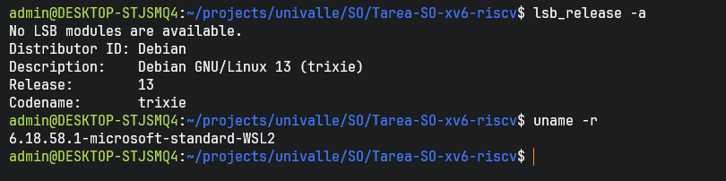

*Figura 1. `lsb_release -a` muestra Debian 13 (trixie) y `uname -r` el kernel de WSL2. El aviso "No LSB modules are available" es normal en Debian.*

Commit de partida y versiones de las herramientas:

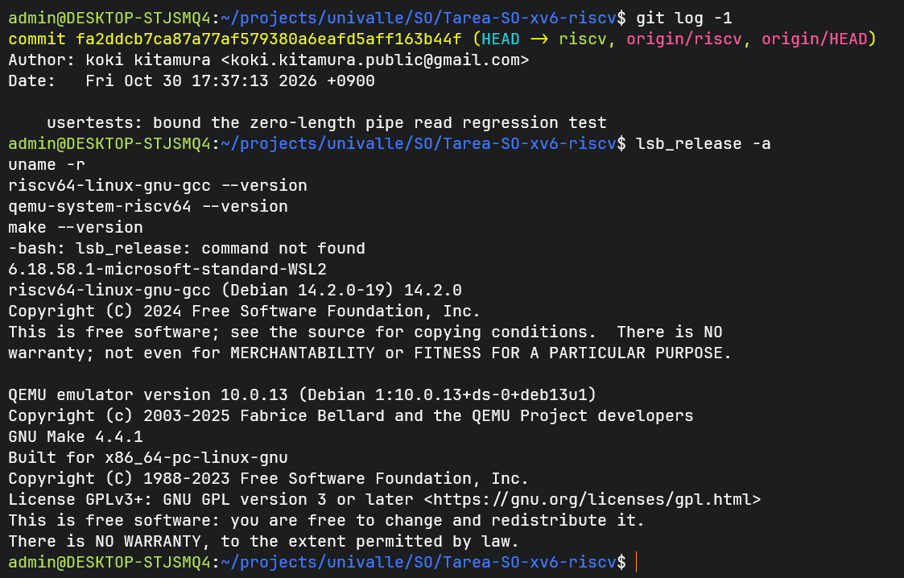

*Figura 2. `git log -1` con el commit de partida, y la versión de gcc, QEMU y make. En esa captura `lsb_release` aún no estaba instalado.*

### 1.3 Instrucciones reproducibles

Desde una terminal de Debian en WSL:

```bash
# 1. Paquetes necesarios
sudo apt update && sudo apt upgrade -y
sudo apt install -y git build-essential gdb-multiarch qemu-system-misc \
  gcc-riscv64-linux-gnu binutils-riscv64-linux-gnu bc lsb-release

# 2. Clonar el fork
cd ~
git clone https://github.com/Nicoramirezc/Tarea-SO-xv6-riscv.git
cd Tarea-SO-xv6-riscv
git log -1          # commit de partida

# 3. Versiones de las herramientas
lsb_release -a
uname -r
riscv64-linux-gnu-gcc --version
qemu-system-riscv64 --version
make --version

# 4. Compilar y ejecutar con las 3 CPUs por defecto
make qemu

# 5. Compilar y ejecutar con una sola CPU virtual
make qemu CPUS=1
```

Dentro de XV6 se usan los comandos `ls` y `cat README`. Para salir de QEMU se pulsa `Ctrl+A` y luego `X`.

Se instaló `bc` porque el objetivo `qemu` del Makefile (regla `check-qemu-version`, línea 198) lo usa para comprobar que QEMU sea 7.2 o superior. Sin `bc`, `make qemu` imprime `bc: not found` y `Illegal number`, pero QEMU arranca igual.

### 1.4 XV6 operativo

Después de `make qemu`, el kernel imprime `xv6 kernel is booting` y `init: starting sh`, y aparece el prompt `$`.

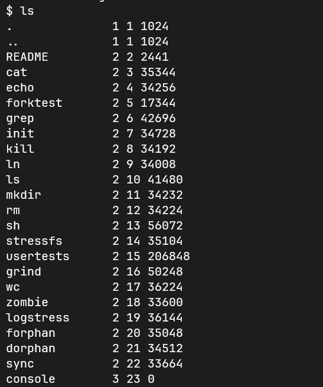

*Figura 3. `ls` en XV6. Cada línea trae nombre, tipo (1 directorio, 2 archivo, 3 dispositivo), número de inodo y tamaño en bytes. Se ven `.` y `..`, el archivo `README`, los programas de usuario (`cat`, `echo`, `grep`, `sh`, `usertests`, entre otros) y `console`, que es un dispositivo (tipo 3).*

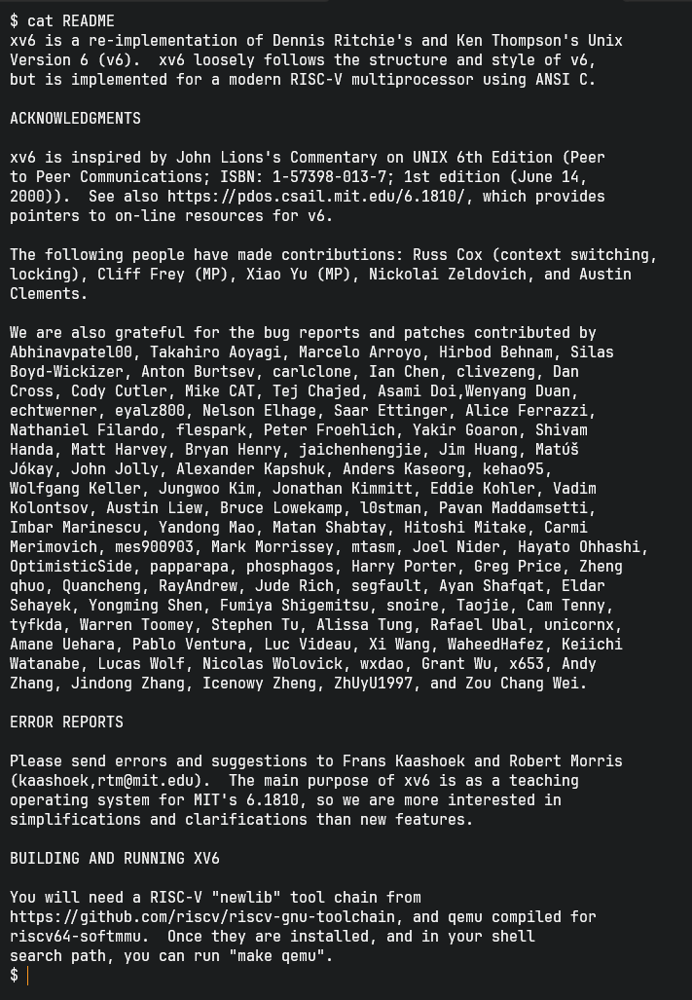

*Figura 4. `cat README` imprime el archivo README del sistema de archivos de XV6: la descripción del proyecto, los agradecimientos y las instrucciones de compilación. Que se pueda leer ese texto muestra que el shell, el sistema de archivos y la consola funcionan.*

### 1.5 Ejecución con una sola CPU virtual

El número de CPUs lo fija la variable `CPUS` del Makefile, que llega a QEMU mediante `-smp`:

```make
ifndef CPUS
CPUS := 3
endif

QEMUOPTS = -machine virt -bios none -kernel $K/kernel -m 128M -smp $(CPUS) -nographic
```

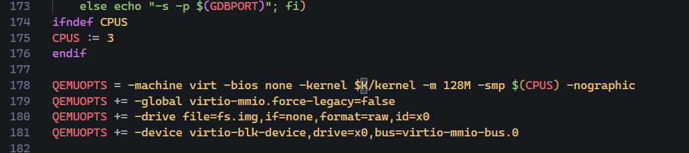

*Figura 5. Líneas 174 a 178 del Makefile. Si `CPUS` no está definida vale 3, y `-smp $(CPUS)` se pasa a QEMU.*

Un valor dado en la línea de comandos tiene prioridad sobre el del Makefile, así que el comando es:

```bash
make qemu CPUS=1
```

Evidencia de que corre con un solo hart:

1. La línea de QEMU que imprime `make` contiene `-smp 1`. Con la ejecución por defecto contiene `-smp 3`.
2. Con las 3 CPUs, el arranque imprime `hart 1 starting` y `hart 2 starting`. Con `CPUS=1` esos mensajes no aparecen.
3. En el monitor de QEMU (`Ctrl+A` y luego `C`), `info cpus` lista una sola CPU:

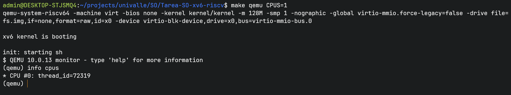

*Figura 6. Con `make qemu CPUS=1`, `info cpus` muestra únicamente `CPU #0`.*

---

## 2. Planificador original

### 2.1 a 2.3 Algoritmo, selección del proceso y estados y eventos (preguntas 3.1 a 3.3 del enunciado)

### 2.4 Cómo entra `proc.c` al sistema compilado (pregunta 3.4 del enunciado)

El código del planificador está en `kernel/proc.c`. Ese archivo llega al sistema que corre en QEMU a través de cinco pasos del Makefile.

**Paso 1. Compilación de `proc.c` a `proc.o`.**
El Makefile no tiene una regla de patrón para los `.c`. La búsqueda `grep -n '%.o' Makefile` solo encuentra la regla de los `.S` (línea 99), la de los programas de usuario (línea 107) y `.PRECIOUS` (línea 131). Los `.c` se compilan con la regla implícita incorporada de `make`, que usa la variable `CFLAGS` definida en las líneas 66 a 89 del Makefile. El log de compilación lo muestra:

```text
riscv64-linux-gnu-gcc -Wall -Werror -Wno-unknown-attributes -O -fno-omit-frame-pointer
 -ggdb -gdwarf-2 ... -march=rv64gc -std=gnu99 -MD -mcmodel=medany -ffreestanding ...
 -fno-pie -no-pie   -c -o kernel/proc.o kernel/proc.c
```

Las opciones `-ffreestanding` y `-mcmodel=medany` indican que es código de kernel, sin biblioteca estándar. Los tres espacios antes de `-c` coinciden con la receta incorporada `$(CC) $(CFLAGS) $(CPPFLAGS) $(TARGET_ARCH) -c`, donde `CPPFLAGS` y `TARGET_ARCH` están vacías.

**Paso 2. La lista `OBJS`.**
`kernel/proc.o` aparece en la línea 15 de la lista `OBJS` (líneas 4 a 31), junto con los demás objetos del kernel.

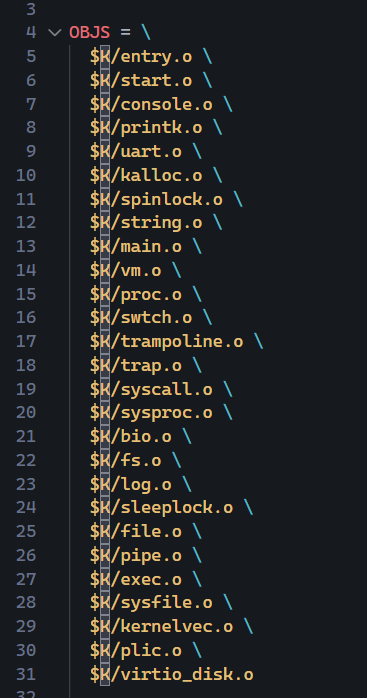

*Figura 7. Lista `OBJS`. `$K/proc.o` está en la línea 15 y `$K/swtch.o` en la 16.*

**Paso 3. Enlazado.**
La regla del kernel usa `OBJS` en dos sitios: como prerrequisito, y como argumento del enlazador.

```make
$K/kernel: $(OBJS) $K/kernel.ld
	$(LD) $(LDFLAGS) -T $K/kernel.ld -o $K/kernel $(OBJS)
	$(OBJDUMP) -S $K/kernel > $K/kernel.asm
	$(OBJDUMP) -t $K/kernel | sed '1,/SYMBOL TABLE/d; s/ .* / /; /^$$/d' > $K/kernel.sym
```

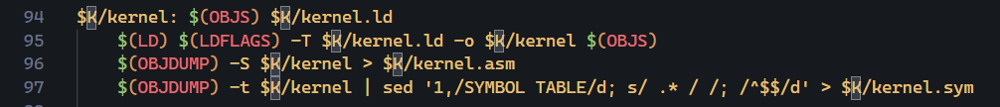

*Figura 8. Líneas 94 a 97 del Makefile. Las líneas `objdump` forman parte de la receta de `$K/kernel` y generan `kernel.asm` y `kernel.sym`.*

El enlazador junta todos los `.o` en un único ejecutable ELF, `kernel/kernel`. Ahí `proc.o` queda mezclado con el resto del kernel: no hay un módulo de planificación separado. El log de `make qemu` lo confirma, porque `kernel/proc.o` aparece en la lista de `riscv64-linux-gnu-ld`.

**Paso 4. El script `kernel/kernel.ld`.**
El script se pasa con `-T`. Dos líneas importan para esta tarea:

```text
2:  ENTRY( _entry )
10: . = 0x80000000;
```

`ENTRY(_entry)` fija el punto de entrada y `. = 0x80000000;` la dirección base. En el ELF resultante, `readelf -h` muestra `Entry point address: 0x80000000` y `readelf -l` un segmento `LOAD` con dirección virtual y física `0x80000000` (`FileSiz 0xa2f0`, `MemSiz 0x23628`, permisos `RWE`). Esos permisos explican el aviso `has a LOAD segment with RWX permissions` que imprime `ld`.

**Paso 5. Carga por QEMU.**
La línea 178 del Makefile pasa el ejecutable con `-kernel $K/kernel`, junto con `-bios none`. Con esas opciones QEMU carga el ELF en la memoria de la máquina virtual y empieza a ejecutarlo. Al arrancar corre `_entry`, y de ahí el kernel llega a `main()` y a `scheduler()`, que están en `proc.c`.

**Dependencias de cabeceras.**
La opción `-MD` hace que cada compilación genere un `.d` en `kernel/` con las cabeceras de las que depende el `.c`. La línea 158 del Makefile los incorpora con `-include kernel/*.d user/*.d`. Por eso modificar un `.h` también provoca la recompilación de los `.c` que lo incluyen.

**Comprobación con tres ejecuciones.**

Se borró `kernel/proc.o` y se ejecutó `make kernel/kernel`. Después se hizo `touch kernel/proc.c` y se repitió. En ambos casos `make` ejecutó las mismas recetas y ninguna otra:

```text
riscv64-linux-gnu-gcc ... -c -o kernel/proc.o kernel/proc.c
riscv64-linux-gnu-ld -z max-page-size=4096 -T kernel/kernel.ld -o kernel/kernel kernel/entry.o ... kernel/proc.o ... kernel/virtio_disk.o
riscv64-linux-gnu-ld: warning: kernel/kernel has a LOAD segment with RWX permissions
riscv64-linux-gnu-objdump -S kernel/kernel > kernel/kernel.asm
riscv64-linux-gnu-objdump -t kernel/kernel | sed ... > kernel/kernel.sym
```

Una tercera ejecución sin tocar nada dio:

```text
make: 'kernel/kernel' is up to date.
```

Las dos primeras corridas muestran que el cambio en `proc.c` solo recompila `proc.o` y vuelve a enlazar. Los demás objetos no se recompilaron. La tercera muestra que `make` decide por fechas de modificación y por las dependencias declaradas, y que `OBJS` entra en esa cadena como prerrequisito de `$K/kernel`.

**Cadena completa:**

```text
kernel/proc.c --(regla implícita de make + CFLAGS)--> kernel/proc.o
kernel/proc.o + demás .o de OBJS --(ld -T kernel.ld)--> kernel/kernel (ELF, entrada 0x80000000)
kernel/kernel --(qemu -kernel kernel/kernel -bios none)--> XV6 en ejecución
```

**Comprobaciones adicionales.**

1. `make -p -n kernel/kernel` lista la regla `%.o: %.c` con la receta `$(COMPILE.c) $(OUTPUT_OPTION) $<`, marcada como `(built-in)`. Es la regla incorporada de `make` que compila `proc.c`, no una regla del Makefile de XV6.

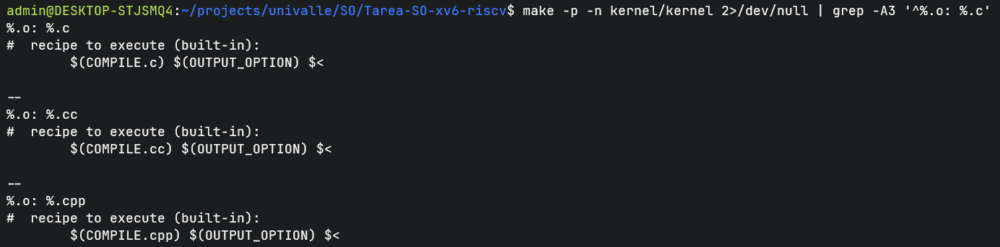

*Figura 9. Salida de `make -p -n kernel/kernel 2>/dev/null | grep -A3 '^%.o: %.c'`.*

2. `nm` sobre `kernel/kernel` ubica el símbolo `_entry` en `0x80000000`, igual que el campo `Entry point address` de `readelf -h`.

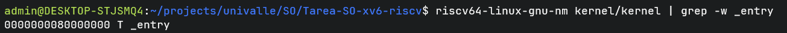

*Figura 10. `riscv64-linux-gnu-nm kernel/kernel | grep -w _entry` da `0000000080000000 T _entry`.*

3. En el monitor de QEMU, `info mtree` muestra que la región `riscv_virt_board.ram` va de `0x80000000` a `0x87ffffff`. Son 128 MiB, el tamaño que se pidió con `-m 128M`. La dirección de `kernel.ld` coincide con el inicio de la RAM de la máquina `virt`.

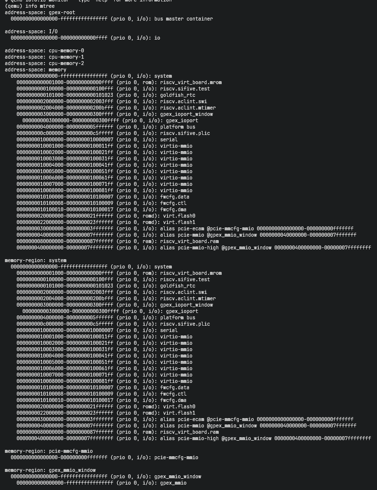

*Figura 11. `info mtree` en el monitor de QEMU. La región `ram` empieza en `0x80000000`; las regiones anteriores son dispositivos y ROM.*

---

## 3. Exploración de MLFQ

---

## 4. Evidencia del aprendizaje con IA

**Servicio y modelo utilizados**

| Integrante | Servicio y modelo |
|---|---|
| Nicolas Andres Ramirez Correa | Claude (Anthropic), modelo Claude Sonnet 5.5 |
| Nicol Vanessa Serna Gómez | |
| Sara Giraldo Mosquera | |

### 4.1 Diálogo sobre compilación, Makefile y una sola CPU

Nicolas Andres Ramirez Correa tuvo un diálogo con la IA en modo tutor socrático sobre compilación, Makefile y una sola CPU. Se seleccionaron dos intercambios.

#### Intercambio 1. De dónde sale la receta que compila `proc.c` (hipótesis, comprobación y corrección)

**Pregunta de la IA.** Si se borra solo `kernel/proc.o` y se ejecuta `make`, ¿qué pasa con `kernel/kernel`? ¿Cambia algo si en vez de eso solo se modifica `proc.c`?

**Hipótesis de Nicolas.** En los dos casos `make` recompila `proc.o` y vuelve a enlazar `kernel/kernel`, sin recompilar los demás objetos, porque `OBJS` es a la vez la lista de argumentos del enlazador y la lista de prerrequisitos de `$K/kernel`. Para pasar de `proc.c` a `proc.o` supuso una regla `$K/%.o: $K/%.c` del Makefile.

**Comprobación.** Nicolas ejecutó `rm kernel/proc.o` y `make kernel/kernel`, luego `touch kernel/proc.c` y de nuevo `make kernel/kernel`. En ambos casos salieron las mismas recetas (compilar `proc.o`, enlazar, dos `objdump`). Una tercera ejecución imprimió `'kernel/kernel' is up to date`. La predicción sobre `OBJS` se confirmó.

**Correcciones.**

- La IA señaló que la predicción usaba una regla `.c` que Nicolas mismo había dicho no encontrar. `grep -n '%.o' Makefile` mostró solo la regla de los `.S` (línea 99). Nicolas concluyó que los `.c` se compilan con la regla implícita incorporada de `make`, que toma las opciones de `CFLAGS`, y después lo confirmó con `make -p` (Figura 9).
- Nicolas había citado `fork.o` como ejemplo de objeto que no se recompila. La IA indicó que no sabía si existía en `OBJS`. No existe: `fork()` está dentro de `proc.c`.
- Nicolas había dicho que `kernel.asm` y `kernel.sym` dependen de `kernel/kernel`. Al leer el Makefile comprobó que las dos líneas `objdump` forman parte de la receta de `$K/kernel` (líneas 96 y 97).

#### Intercambio 2. Qué necesita QEMU dentro del archivo `kernel/kernel` (hipótesis y comprobación)

**Pregunta de la IA.** Con `-kernel kernel/kernel` y `-bios none`, QEMU solo tiene el contenido del archivo. ¿Qué información debe haber dentro para saber en qué dirección colocarlo y desde dónde ejecutarlo, y qué parte de la construcción la puso ahí?

**Hipótesis de Nicolas.** El archivo debe ser un ELF con un punto de entrada en la cabecera (`e_entry`) y un segmento `LOAD` con la dirección donde copiarlo. Esa información la pone el enlazador a partir de `kernel.ld`: `ENTRY(_entry)` para la entrada y `. = 0x80000000;` para la dirección base. Nicolas predijo `Entry point address: 0x80000000` y un `LOAD` en esa dirección.

**Comprobación.** `readelf -h` dio `Entry point address: 0x80000000`. `readelf -l` mostró un `LOAD` en `0x80000000` con `FileSiz 0xa2f0`, `MemSiz 0x23628` y permisos `RWE`. `grep` sobre `kernel.ld` dio `ENTRY( _entry )` en la línea 2 y `. = 0x80000000;` en la 10. La predicción coincidió. La diferencia entre `MemSiz` y `FileSiz` corresponde al espacio que ocupa la sección `.bss`, que no está en el archivo.

**Límites señalados por la IA.** `readelf` muestra qué hay en el archivo, no qué lee QEMU. Nicolas tampoco había cruzado el símbolo `_entry` con la dirección ni mostrado todos los segmentos. La IA propuso mirar el mapa de memoria del emulador con `info mtree`.

**Comprobaciones posteriores.** `nm` ubicó `_entry` en `0x80000000` (Figura 10) y `info mtree` mostró que la RAM de la máquina `virt` empieza en `0x80000000` y mide 128 MiB (Figura 11).

**Dos errores de la IA durante el diálogo.** En un comando agrupó `make qemu-gdb`, que deja QEMU en primer plano, y los comandos siguientes no se ejecutaron; se repitió el experimento sin esa línea. Más tarde dijo que la línea de `gcc` de Nicolas descartaba la regla incorporada de `make`, y se corrigió: esas opciones llegan por `CFLAGS` y no distinguen entre las posibilidades. Lo que decidió fue la búsqueda en el Makefile.

**Cierre del diálogo.** Nicolas terminó la conversación antes de que la IA diera una conclusión final, porque cada respuesta suya llevaba a una pregunta nueva y el diálogo no convergía. En sus últimos mensajes la IA dijo que su conclusión sobre la cadena `proc.c` → `proc.o` → `kernel/kernel` era correcta y estaba bien razonada, y que su predicción sobre `readelf` coincidió con la evidencia. También marcó qué afirmaciones aún no tenían respaldo, y Nicolas las comprobó después (Figuras 9 a 11 y la línea 158 del Makefile).

### 4.2 Diálogo sobre el planificador original

### 4.3 Diálogo sobre MLFQ

---

## 5. Párrafos individuales

**Nicolas Andres Ramirez Correa.**
Nicolas entendió cómo `kernel/proc.c` termina en el sistema que corre en QEMU: `make` lo compila a `proc.o` con la regla implícita y `CFLAGS`, `OBJS` lo incluye en el enlace y como prerrequisito de `$K/kernel`, `ld` lo une con los demás objetos usando `kernel.ld`, y QEMU carga el ELF resultante con `-kernel`. También entendió que el número de CPUs depende de `CPUS` y de `-smp`, y lo comprobó con `info cpus` y con los mensajes `hart N starting`. Su aporte fue preparar el entorno en WSL, recoger la evidencia de compilación y ejecución, escribir la sección 2.4 y ensamblar el reporte. Se equivocó en varias suposiciones durante el diálogo (una regla `.c` en el Makefile, la existencia de `fork.o` y la dependencia de `kernel.asm`) y las corrigió al leer el Makefile y ejecutar los comandos. Con `make -p` confirmó que la receta de los `.c` es la incorporada de `make`, con `nm` que `_entry` está en `0x80000000` y con `info mtree` que esa dirección es el inicio de la RAM de la máquina `virt`. Aún necesita estudiar con más detalle cómo carga QEMU el ELF por dentro.

**Nicol Vanessa Serna Gómez.**

**Sara Giraldo Mosquera.**
